# Architecture

How Smart-Clearance is built, as of 15 October 2026. This document names every technology in the solution, shows how
the parts fit and why they were chosen, follows one batch through the whole system, and gives what it costs and how it
performs on production. [README.md](README.md) is the guide to running and operating it, [TESTING.md](TESTING.md) to
testing it, and [AGENTS.md](AGENTS.md) holds the rules it is worked on by.

**The diagrams.** The pictures are exports of four Lucidchart documents. They are kept in
[`docs/architecture/`](docs/architecture/), and each one links to the document it came from. Mermaid, which GitHub
renders, draws what Lucid does not: the code's own structure, how the agents are orchestrated, the data model, the
case's states and the destruction at the godown. [The diagrams' sources](#23-the-diagrams-sources) says how to refresh
them.

**Agent Platform.** In April 2026 Google renamed Vertex AI to Gemini Enterprise Agent Platform, and its Agent Engine to
Agent Runtime. This document uses the new names. Nothing in the build changed with them: Gemini is still reached at
`aiplatform.googleapis.com`, under the IAM role `roles/aiplatform.user`, and the google-genai SDK's `enterprise=True`
is its former `vertexai=True`.

## Contents

1. [The system in one picture](#1-the-system-in-one-picture)
2. [Surfaces and their status](#2-surfaces-and-their-status)
3. [Google Cloud, layer by layer](#3-google-cloud-layer-by-layer)
4. [The technology, with versions](#4-the-technology-with-versions)
5. [The application flow](#5-the-application-flow)
6. [The agents](#6-the-agents)
7. [backend-api](#7-backend-api)
8. [Events, time and the live stream](#8-events-time-and-the-live-stream)
9. [The data](#9-the-data)
10. [The frontend](#10-the-frontend)
11. [The design prototypes, design3](#11-the-design-prototypes-design3)
12. [Identity, secrets and security](#12-identity-secrets-and-security)
13. [The cloud runtime](#13-the-cloud-runtime)
14. [Delivery: CI, builds and deploys](#14-delivery-ci-builds-and-deploys)
15. [Local development](#15-local-development)
16. [Testing and quality](#16-testing-and-quality)
17. [Performance, cost and scale](#17-performance-cost-and-scale)
18. [Observability: one request, one trace](#18-observability-one-request-one-trace)
19. [Accessibility and motion](#19-accessibility-and-motion)
20. [Decisions and their reasons](#20-decisions-and-their-reasons)
21. [Known gaps](#21-known-gaps)
22. [What comes next](#22-what-comes-next)
23. [The diagrams' sources](#23-the-diagrams-sources)

## 1. The system in one picture

[](https://lucid.app/lucidchart/0e33214e-b46f-4cfb-9413-b2c40de7d1c6/view)

*Lucid: Smart-Clearance Architecture on Google Cloud, page 1.*

Four static web apps on Firebase Hosting's CDN talk to one API, **backend-api**, on Cloud Run. backend-api is the only
writer of the system of record, one PostgreSQL database on Cloud SQL, and checks every sign-in against Firebase
Authentication. Each change it makes is committed with its audit line and its outbox rows. The events then leave
through Pub/Sub to the **agents**, a second Cloud Run service of Google ADK pipelines on Gemini through Agent Platform. The
agents read the facts they need, ask Gemini for words against an output schema, check every figure, and report back
to backend-api's `/internal` routes. They never connect to PostgreSQL. Cloud Scheduler ticks the journey's clock every
minute. The members' screens follow the journey over server-sent events, and pushes reach their phones through Firebase
Cloud Messaging. BigQuery keeps the analytics (sell-through, prices, the impact ledger, every agent run) and Cloud
Storage the files (label photos, stock exports, the papers' PDFs).

Everything runs in one Google Cloud project, `aibuilder-510213`, in `asia-south1` (Mumbai), written in Terraform.
GitHub Actions gates every change and, on `main`, releases it without a stored key.

The one rule that shapes the rest: **Gemini writes the words; backend-api computes every figure.** A price, a split, a
credit note or a ledger row is never a model's guess. It comes from `domain/money.py`, a port of design3's `money.js`,
held to it by fixtures. The models write the notes, the offers, the listing and the replies, and a check refuses any
sentence that quotes a figure the computation did not produce.

**Who orchestrates.** Code, not a model. backend-api's journey state machine decides every next step and publishes it
as an event; the agents service maps each event to one fixed pipeline of ADK workflow agents; and the two steps that
release or destroy stock wait for a person's yes. No model ever chooses which agent runs next.
[How the agents are orchestrated](#how-the-agents-are-orchestrated) has the detail.

## 2. Surfaces and their status

| Surface | Address | Prototype (design3) | Production | Backend |
| --- | --- | --- | --- | --- |
| Landing page | [smartclearance.web.app](https://smartclearance.web.app) | `site/` | `frontend/admin`, prerendered | backend-api: showcase, catalog, workspace lookup, demo requests |
| Staff console | [smartclearance-console.web.app](https://smartclearance-console.web.app) | `console/` | `frontend/console`, a thin host for `core/console` | backend-api `/v1/console`, Firebase sign-in |
| A client's workspace app (Munchly Foods) | [munchly-smartclearance.web.app](https://munchly-smartclearance.web.app) | `app/`, an installable PWA | `frontend/workspace`, a thin host for `core/workspace` | backend-api `/v1/workspaces/{ws}`, the agents, SSE and FCM |
| Guided demo | [smartclearance-demo.web.app](https://smartclearance-demo.web.app) | `demo/` | `frontend/demo`, the route map | none: the workspace's stub and the console's demo world, in the browser |
| Design system v3 | design3, served locally | `system/` | `frontend/core`, and `/ds` on the landing page's dev server | none |
| The agents | internal only | the reconciler in `core/flow.js` | `agents/`, on Cloud Run | report to backend-api's `/internal` |

Every app also runs with no backend at all. Without `PUBLIC_API_BASE`, the landing page and the console use in-browser
mocks seeded from design3, and the workspace app uses the prototype's stub, which runs the whole journey in the browser.
A live build of the workspace carries none of the stub, and a build check (`no-seed.mjs`) proves it.

### One platform, many clients

Smart-Clearance is sold to manufacturers as software as a service, and one deployment serves every client:

- **One API and one database.** Every client's rows carry its client id, and every answer is cut to its client and
  the asker's role before it leaves (section 7). The agents read each client's own settings at the start of every run.
- **A workspace per client.** The workspace app is built once for each client, its workspace named at build time
  (`PUBLIC_WORKSPACE_ID`), and served from that client's own Hosting site at `<client>-smartclearance.web.app`.
  Munchly Foods' is the one live today.
- **Set up in the console.** Staff turn a demo request into a client in seven steps (company, workspace, supply chain,
  exits, agents, people, review), then upload its first stock export, which the Data agent maps.
- **Each client's own rules.** Quick-commerce gates per SKU with per-batch overrides, the Negotiator's hidden reserve,
  the exits it uses, the leftovers policy and its waste agencies, the journey's day length, and how far each agent
  goes: suggest, ask or act, from a preset (cautious, standard or trusted), then agent by agent. The plan's approval
  is a gate no setting removes.

## 3. Google Cloud, layer by layer

[](https://lucid.app/lucidchart/631bbb66-9b43-4e20-abf0-f44fa6a68174/view)

*Lucid: Smart-Clearance Google Cloud and AI, page 1.*

| Layer | Service | What it does here | Why this one |
| --- | --- | --- | --- |
| Experience | **Firebase Hosting** | the four SvelteKit apps, one site each, on Google's CDN; SPA rewrites; `/_app/immutable/` cached for a year | static builds need no server; every byte is cacheable at the edge |
| Identity | **Firebase Authentication** (Identity Platform) | email and password for everyone, one user pool, sign-up off; a password policy and email enumeration protection | one pool for staff, the client's people and its partners; accounts made only by the API |
| Messaging | **Firebase Cloud Messaging** | pushes to phones and browsers through the PWA's service worker | free, and the same SDK as sign-in |
| Compute | **Cloud Run** | the `backend-api` service (public), the `agents` service (internal), and two jobs, `backend-api-migrate` and `backend-api-hydrate` | containers that scale to zero, each as its own service account |
| Intelligence | **Gemini on Agent Platform** (Gemini Enterprise Agent Platform, formerly Vertex AI) | `gemini-3.1-pro-preview` where judgement and tone matter, `gemini-3.8-flash` for reading and drafting, on the global endpoint (`aiplatform.googleapis.com`) | structured output, multimodal labels, no API key (the service account's own credentials) |
| Intelligence | **Agent Development Kit** (google-adk) | workflow agents (`SequentialAgent`, `ParallelAgent`) of deterministic steps and `LlmAgent`s with output schemas, in the agents' own Cloud Run service | Google's framework for multi-agent pipelines, traced with OpenTelemetry; the same agents could move to Agent Runtime |
| Events | **Cloud Pub/Sub** | the agents' topics, ordered by batch, pushed with OIDC; dead letters after five tries | at-least-once delivery that survives a cold start, with ordering per batch |
| Time | **Cloud Scheduler** | `sc-tick` every minute: daily runs, due timers, stalled journeys, the outbox | a clock the API does not have to keep alive |
| Data | **Cloud SQL** for PostgreSQL 18 | `sc-main`: the system of record and its append-only audit log | relational truth with transactions; IAM logins only |
| Data | **BigQuery** | dataset `smartclearance`: sell-through, stock, prices, the impact ledger, agent runs and evals | the agents' analytics, apart from the record |
| Data | **Cloud Storage** | three private buckets per environment: photos, exports, docs, opened by short-lived signed URLs | the files people and agents upload and print |
| Trust | **Secret Manager** | three secrets, read by reference at runtime | nothing secret in a file, a command line, state or git |
| Trust | **IAM** and **Workload Identity Federation** | a service account per job, none with a key; GitHub deploys from `main` without a stored credential | keyless everywhere |
| Delivery | **Cloud Build** and **Artifact Registry** | builds, migrates and deploys both Cloud Run services; private images tagged with their commit | the release runs inside the project, as `sc-builder` |
| Operations | **Cloud Logging, Error Reporting, Cloud Trace, Cloud Monitoring, Billing** | JSON logs with their trace; sampled spans over OTLP; an uptime check, 11 alert policies, a dashboard; a GBP 30 budget | Google's own stack, so a request's line, span and audit row link up |

**Why not Firestore.** Firebase is used for what it is best at: hosting, sign-in and pushes. The record is
relational, needs transactions that span a change, its audit line and its outbox, and is held to fixtures by SQL
views. So it lives in Cloud SQL, and the live screens are fed by PostgreSQL's `LISTEN/NOTIFY` and server-sent events
rather than Firestore listeners.

**Why Cloud Run, not Agent Runtime.** Agent Platform's managed home for ADK agents, Agent Runtime (formerly Agent
Engine), would host the agents for us. They run in their own Cloud Run service instead: Pub/Sub pushes to it directly,
it scales to zero beside backend-api, and the two share one way to deploy, sign in, log and trace. The agents need no
managed sessions or memory either: backend-api holds the record, and each run's session is thrown away at its end.
Their tools are plain HTTP calls with a Google ID token, so the agents can move to Agent Runtime unchanged.

## 4. The technology, with versions

Versions are those resolved in the lockfiles on 11 October 2026.

### design3, the prototypes

| Piece | Technology |
| --- | --- |
| Pages | static HTML; React 18.3 and framer-motion 11 from a CDN; every `.jsx` compiled to `.js` by esbuild (`build.sh`); `dist.sh` bundles the hosted build |
| Styling | plain CSS on design tokens (`system/tokens.css`, `base.css`, `components.css`, `screens.css`), light and dark |
| Rules and data | `core/money.js` (every figure, from Journey Map v4.1), `data.js` (the fictional dataset and the parties' identities), `world.js` (addresses, the kiranas, numbering), `platform.js` (the console's mock backend and rules of record), `flow.js` (the journey as actions with an agent reconciler), `ledger.js` (the history, the ledger, the partners' and the record's views), `papers.js` (the GST papers' working: the e-invoice, amounts in words), `store.js` |
| Imagery | Qwen-Image 2.1 renders and LTX 2.5 clips locally; Veo 3.1 clips and Nano Banana 2 (Gemini 3.1 Flash Image) keyframes on Agent Platform through `tools/vertex-media/`, each call priced before it is made; every asset with a `.prompt.json` sidecar; only WebP ships |
| Films | the demo films: Veo 3.1 scenes at 1080p, Nano Banana 2 cast sheets and keyframes, Gemini-TTS narration and a Lyria 2 score on Agent Platform, with Qwen-Image, LTX 2.5 and ffmpeg locally |
| Labels | the label maker, `system/labels/`: the statutory sticker printed onto a Qwen base photo, every barcode and QR code read back |
| Hosting | static pages served locally; hosted copies load `dist/` from jsDelivr and images from GitHub raw, pinned to a commit SHA |

### The frontend

| Area | Technology |
| --- | --- |
| Framework | SvelteKit 3.0, Svelte 5.57 (runes), Vite 8.3, TypeScript 6.0; Node 22.17 or later (CI uses 24) |
| Workspace | pnpm 12.9 through corepack; seven packages with one catalog of shared versions |
| Output | `@sveltejs/adapter-static` 4.0: the landing page prerendered with its data (`200.html` as the SPA fallback); the console, the workspace and the demo client-side apps |
| Styling | design3's CSS ported verbatim, with Tailwind 4.3's theme and utilities over its tokens (no preflight) |
| Primitives | bits-ui 2.19 for menus, sheets and dialogs |
| Icons | `@lucide/svelte` 1.51, through a registry generated from design3's icon names |
| Data | TanStack Query 6.3 over typed clients in `@smart-clearance/api`; the workspace's live source over HTTP, SSE and signed uploads |
| Sign-in and pushes | `firebase` 12.19 (Auth and Messaging), loaded only by a live build |
| Motion | `motion` 14 and Svelte transitions, with the prototype's springs |
| Fonts | Fontsource variable fonts 5.3: Bricolage Grotesque, Geist, Geist Mono, Noto Sans Devanagari |
| Tests | Vitest 5.0 with Testing Library and jsdom; Playwright 1.63 with @axe-core/playwright 4.13; pixelmatch 7.2 |
| Lint | ESLint 10.12 with typescript-eslint and eslint-plugin-svelte; Prettier 3.9; svelte-check 4.7 |

### backend-api

| Area | Technology |
| --- | --- |
| Runtime | Python 3.14, uv 0.12 (`uv.lock` committed), ruff 0.16 |
| API | FastAPI 0.142 (Starlette 1.7) on Uvicorn 0.54; Pydantic 2.13 and pydantic-settings 2.15; slowapi 0.1 for rate limits; SSE as a plain Starlette `StreamingResponse` |
| Database | SQLAlchemy 2.1 (async) on asyncpg 0.31; Alembic 1.20; `cloud-sql-python-connector` 1.22 in the cloud |
| Google | `firebase-admin` 7.7 (ID tokens, accounts, FCM); `google-auth` 2.60; `google-cloud-secret-manager` 2.31, `-pubsub` 2.42, `-storage` 3.16 |
| Tracing | OpenTelemetry SDK 1.45 with the FastAPI, SQLAlchemy, requests and ASGI instrumentations (0.66b1); OTLP over gRPC to the Telemetry API |
| Synthetic data | Faker 40 (`en_IN`), seeded |
| Container | `python:3.14-slim`, two stages with uv, an unprivileged user, port 8080 |
| Tests | pytest 9.1 with pytest-asyncio and httpx, on a real PostgreSQL |

### The agents

| Area | Technology |
| --- | --- |
| Runtime | Python 3.14 (3.13 also tested in CI), uv 0.12, ruff 0.16 |
| Agents | google-adk 2.11 (`SequentialAgent`, `ParallelAgent`, `LlmAgent`, `BaseAgent` steps) on google-genai 2.28, which reaches Agent Platform with `enterprise=True` |
| Service | FastAPI 0.141 on Uvicorn 0.54 (the push service); a pull worker for local development |
| Google | `google-cloud-pubsub` 2.42, `-storage` 3.16, `-bigquery` 3.46; `google-auth` 2.60 |
| Papers | WeasyPrint 70 with Jinja2 3.1 (the PDFs, with Pango), segno 1.6 (the e-invoice's QR code) |
| Resilience | tenacity 9.1, httpx 0.28 |
| Tracing | OpenTelemetry 1.42 (the version ADK allows), with the FastAPI, httpx and requests instrumentations |
| Container | `python:3.14-slim`, two stages, Pango, HarfBuzz and the DejaVu and Noto fonts, uid 10001, port 8080 |

### Infrastructure and delivery

| Area | Technology |
| --- | --- |
| Infrastructure as code | Terraform 1.9 or later (CI runs 1.16) with `hashicorp/google` and `google-beta` 8.5 and `integrations/github` 6.13; state in GCS |
| CI | GitHub Actions, every action pinned to a commit SHA; gitleaks 8.30 |
| Releases | Cloud Build for the two Cloud Run services; firebase-tools 15.32 through `npx` for Hosting |

## 5. The application flow

### The core loop

Every stop of a batch's journey runs on one loop: a person acts in an app, backend-api records it, the agents add
their part, and every member's screen moves on.

[](https://lucid.app/lucidchart/2965aa52-3190-4d68-8791-9c95c8fd7bbc/view)

*Lucid: Smart-Clearance Application Flow · the core loop.*

1. **A person acts** in the workspace app: a tap, a photo, a yes. The app sends the action with the member's Firebase
   ID token (the SDK refreshes it), an `Idempotency-Key`, and a W3C `traceparent`.
2. **backend-api verifies the token** with `firebase-admin`, finds the member and their role, and checks that the
   role may do this (`reference/rbac.json`).
3. **One transaction** writes the change, its timeline entry (`feed_events`), its audit line in the person's name,
   its stream row and its outbox rows. A repeated `Idempotency-Key` answers what the first call answered.
4. **After the commit**, `pg_notify` wakes the stream. Every member connected over SSE gets the change, cut to what
   their role may see: a buyer never sees the reserve, a kirana sees only its own offer.
5. **The outbox is published** to Pub/Sub, in order per batch (ordering key `client:ref`).
6. **Pub/Sub pushes** the event to the agents, signed with an OIDC token as `sc-invoker`.
7. **The agents read the case** on `/internal` with a Google ID token as `sc-agents`, and read anything else they need
   from BigQuery and Cloud Storage.
8. **Gemini writes the words** against an output schema. The agent checks every figure against the computed ones.
9. **The agent reports** to `/internal` with its event key, so a redelivered event is a no-op.
10. **backend-api applies the report** in one transaction (the next change, its audit line, the next event), and
    **pushes** to the members it concerns through FCM.

### A batch's journey, request by request

[](https://lucid.app/lucidchart/c2efb94b-7aa2-4cc1-a6cc-af4980ff255f/view)

*Lucid: Smart-Clearance Application Flow · a batch's journey.*

| Stop | Who acts | What triggers it | Agent and model | What it leaves behind |
| --- | --- | --- | --- | --- |
| **Connect** | a distributor, or staff in the console | an upload to a signed URL, then `export.uploaded`; and the Data agent's daily run at 08:30 journey time | **Data**: its saved layout, or Flash to map a header layout it has not seen | stock and sell-through in BigQuery; the column map on the workspace |
| **Detect** | Cloud Scheduler | `agent.due` for the Watcher at 09:00 journey time | **Watcher**: a BigQuery query of 28-day sell-through, no model | a case per batch that will not sell in time and fails every quick-commerce gate; a push to the operator |
| **Verify** | the distributor | `batch.at_risk`, then the photo sent | **Vision**: asks for a label photo (a push), then reads the printed label with Flash, multimodal | the label read; a mismatch asks for a retake, with the reason |
| **Value** | none | `journey.step value` (or `decide`, after Vision) | **Valuer**: Pro writes one note an exit, on backend-api's valuation preview | every exit priced by the money rules |
| **Decide** | none | `journey.step route` | **Router**: Pro explains the split in plain words, quoting only the plan | the plan, waiting for a yes |
| **Approve** | the operator (Priya) | the plan's approval sheet | none: **a person's yes**, never an agent's | the plan approved, its audit line in the approver's name |
| **Execute** | the agents, then kiranas, the buyer, the distributor, the food bank | `journey.step execute`, then each partner's move; `offer.received`, `deal.closed` | a `ParallelAgent`: **Lister** (Flash, the marketplace listing), **Outreach** (Flash, the kiranas' offer in Hindi, English and Marathi), **Donation** (no model: the food bank is booked). Then the **Negotiator**: backend-api decides the counter; Pro words the reply to a bid, Flash answers a buyer's question | the kiranas' orders, each with its tax invoice; the lot awarded; the staff sale recorded; the pickup collected with its receipt |
| **Settle** | the distributor, then the operator | `journey.step settle` once every line is done | **Paperwork**: backend-api drafts every paper, numbered in its series; the agent lays each out as a PDF in the docs bucket (Flash only for an optional cover note) | the tax invoice with its e-invoice, credit notes, the GST ITC memo, the FSSAI checklist, the receipt; Priya's review |
| **Report** | Cloud Scheduler, or the console's Report now | the `report.due` timer at best-before | **Impact**: one `impact_ledger` row an exit in BigQuery, no model by default | packs left at the godown settled by the client's expiry policy; the ledger posted; the case cleared |

A batch in a journey moves through ten phases. `domain/journey.py` maps each phase to the stop it shows, as `flow.js` does in the
prototype:

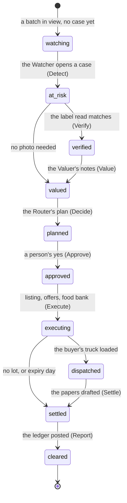

### Destroyed at the godown, against evidence and a second yes

When packs are still at the godown on expiry day and the client's policy is `godown`, nothing closes until
the distributor has shown the destruction and the operator has approved it. Lucid's journey ends at the report, so
this path is drawn here:

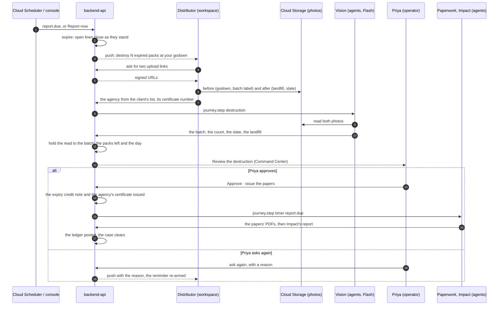

## 6. The agents

[](https://lucid.app/lucidchart/0e33214e-b46f-4cfb-9413-b2c40de7d1c6/view)

*Lucid: Smart-Clearance Architecture on Google Cloud, page 2.*

The agents service (`agents/`) is stateless: **one run an event**. A Pub/Sub push arrives at `POST /pubsub`, the
dispatcher builds the pipeline for that event, ADK's `Runner` runs it on an in-memory session, and the run's last step
reports to backend-api. Nothing is kept between runs. A run that has nothing left to do (a stale event, a step already
reported) ends as a no-op, so redelivery is safe.

| Module | What it is |
| --- | --- |
| `service.py` | the Cloud Run app: `POST /pubsub` answers 204 (done, no-op, failed, unreadable), 503 (transient, so Pub/Sub redelivers) or 400; `/healthz`, `/readyz` |
| `worker.py` | the local pull worker: streams the four `local.agents.*` subscriptions, one message at a time, 590 s a run |
| `dispatch.py` | runs a pipeline under `RunConfig(max_llm_calls)`, maps errors to outcomes, writes one `agent_runs` row to BigQuery |
| `pipelines/` | `build()`: the event to its pipeline |
| `agents/` | one module an agent, plus `common.py` (`load_settings`, `load_case`, `cut_case`, which strips the reserve) |
| `models.py` | the model tier (live, or stub recordings for tests), `writer()`, `Bounded`, retries, the budget |
| `checks.py` | the copy checks: figures, lengths, the price stated, buyers' words quoted |
| `backend.py`, `gcp.py` | the `/internal` client and its Google ID token |
| `tools/` | BigQuery, Cloud Storage, `pdf.py` (Jinja2 and WeasyPrint), `papers.py` (amounts in words, the IRN, the QR code) |
| `prompts/`, `templates/` | 11 prompts; the papers' 12 templates (Tally's invoice and its children, credit and expiry notes, the destruction certificate, the ITC memo, the FSSAI checklist, the receipt, the kirana invoice) |
| `recordings/` | one recorded answer a writer, for `MODEL_TIER=stub` |
| `evals/` | the harness, the judge, the scorers |

### How the agents are orchestrated

Code decides what runs, at every level; a model only writes words inside a step.

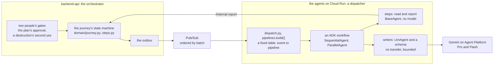

1. **backend-api is the orchestrator.** The journey is a state machine in code: `domain/journey.py` says which moves
   each phase allows, and `services/journey/steps.py` applies every person's move and every agent's report in one
   transaction, then publishes the next event. Cloud Scheduler's tick adds the daily runs and the timers.
2. **The agents service is a dispatcher.** `dispatch.py` takes each Pub/Sub message, and `pipelines.build()` looks its
   event up in a fixed table (below) and builds that one pipeline. The event says which agents run; nothing in the
   agents decides it.
3. **Each pipeline is an ADK workflow.** A `SequentialAgent` where a step needs the one before (`decide` is Vision,
   then the Valuer, then the Router), a `ParallelAgent` where it does not (`execute` runs the Lister, Outreach and
   Donation side by side). Inside, deterministic steps (`Step`, a `BaseAgent`) read backend-api, BigQuery and Cloud
   Storage and report; writers make the model calls.
4. **A writer is one bounded model call:** an `LlmAgent` with an output schema, `include_contents="none"` (it sees only
   the facts it is handed), and transfer to its parent and peers switched off, inside `Bounded`
   ([A model call, bounded](#a-model-call-bounded)).

So the agents never call each other: every hand-off goes through backend-api and Pub/Sub. ADK's model-driven delegation
(a coordinator `LlmAgent` that transfers to sub-agents, or agents used as tools) is not used, because a price, a split
or a paper must come out the same every time, be tested against fixtures, and trace back to the rule that made it. The
two steps that let stock go, the plan's release and a destruction, wait in backend-api for a person's yes, which no
agent can give.

### Events and their pipelines

| Stop | Event | Pipeline |
| --- | --- | --- |
| Connect | `journey.step export.uploaded`, `agent.due data`, `agent.run_now data` | Data |
| Detect | `agent.due watcher`, `agent.run_now watcher` | Watcher |
| Verify | `batch.at_risk` | Vision asks for a photo |
| Verify, Value, Decide | `journey.step decide` | Vision reads, then the Valuer, then the Router |
| Value, Decide | `journey.step value` | the Valuer, then the Router |
| Decide | `journey.step route` | the Router |
| Execute | `journey.step execute` | `ParallelAgent`: the Lister, Outreach and Donation |
| Execute | `offer.received {bid}`, `offer.received {message}` | the Negotiator: a bid's reply, or a question's answer |
| Execute | `deal.closed` | the award price into BigQuery's `channel_prices` |
| Settle | `journey.step settle`, `receipt`, `kirana` | Paperwork: the pack, the food bank's receipt, a kirana's invoice |
| Report | `journey.step destruction` | Vision checks the destruction evidence |
| Report | `journey.step timer {report.due}` | Impact |

Every pipeline but `deal.closed` starts by loading the client's agent settings. An agent the client has switched off
does nothing: the journey waits, and the tick sends the event again later. `notify` is not the agents' topic:
backend-api's Notifier takes it.

### The agents and their models

[](https://lucid.app/lucidchart/631bbb66-9b43-4e20-abf0-f44fa6a68174/view)

*Lucid: Smart-Clearance Google Cloud and AI, page 6.*

Two tiers, chosen by what the words are for. **Pro** (`gemini-3.1-pro-preview`) where a person decides on the words:
the Valuer's notes, the Router's explanation, the Negotiator's reply to a bid, and the evals' judge. **Flash**
(`gemini-3.8-flash`) for reading and drafting: Vision's label read (multimodal), the Data agent's header map, the
listing, the kiranas' offer, a buyer's question, Paperwork's cover note and Impact's narrative. Structured output runs
at temperature 0.2 with low thinking; the offers' copy at 0.7. The model ids are Terraform variables (`model_pro`,
`model_flash`), so a model can change without a code change. Both are reached on Agent Platform's global endpoint,
where the Gemini 3 models are served, as the agents' own service account (`sc-agents`, with `roles/aiplatform.user`):
no API key exists. [Performance, cost and scale](#17-performance-cost-and-scale) has each agent's latency and cost on
production.

### A model call, bounded

[](https://lucid.app/lucidchart/631bbb66-9b43-4e20-abf0-f44fa6a68174/view)

*Lucid: Smart-Clearance Google Cloud and AI, page 7.*

- **The facts** are backend-api's previews on `/internal`: the valuation, the plan and a bid's preview, with every
  figure already computed. Cloud Storage and BigQuery supply the rest.
- **The case is cut** before any prompt: the reserve price, the money rules and anything the agent does not need are
  removed. A buyer's own words are quoted between delimiters.
- **Every schema field is required**, `null` standing for "not there", and maps are lists of pairs (Gemini's
  structured output drops free-keyed maps and optional fields). `tests/test_schemas.py` holds every schema and
  recording to that.
- **Retries:** up to three attempts on 429, 500, 503 and 504, 30 s each, with backoff (1 s, then 2 s, plus up to 1 s
  of jitter). `Bounded` gives the whole call 95 s, and a run makes twelve model calls at most.
- **The checks** (`checks.py`): every figure in the words must be a computed one; the Negotiator states only the
  decided price, never the reserve; lengths are capped (a listing title 100 characters, the Router 600, a Valuer note
  160, an offer 220 and naming `{shop}`).
- **A check that fails** lets backend-api's own template stand in, and marks the run `fallback`. Vision instead asks
  for a redelivery until its last attempt.
- **Every run** is a row in BigQuery's `agent_runs`: model, tokens, latency, fallback and trace.
- **Readiness:** `/readyz` reads both models' metadata (no generation) and caches a pass for ten minutes. The cache
  starts at minus infinity, so a new container always checks.

### The evals

The evals run on live Gemini, on request only (`agents/scripts/eval.sh`, about GBP 2 a run), into BigQuery's
`agent_evals`. Each set has train and held-out cases; the judge is Pro at temperature 0, scoring each criterion from 1
to 5 against a rubric.

| Set | Cases | Last run (7 to 8 Oct) |
| --- | --- | --- |
| Vision | 73 photos from the label maker | 72 of 73; no confident wrong read |
| Data | 19 | 25 of 25, on the set before its six shelf cases were retired |
| Valuer | 20 | 19 of 20, rubric 5 |
| Router | 20 | 20 of 20, rubric 4.61 |
| Lister | 15 | 15 of 15 |
| Outreach | 15 | 15 of 15 |
| Negotiator | 40 | 38 of 40; the reserve never leaked |

The Negotiator's and the Valuer's three misses were the Pro preview's quota (429) after every retry, each falling back
to its template. Every pull request replays each writer's recorded answers on the stub tier, with no live model.

## 7. backend-api

One FastAPI application, layered so that only the services write.

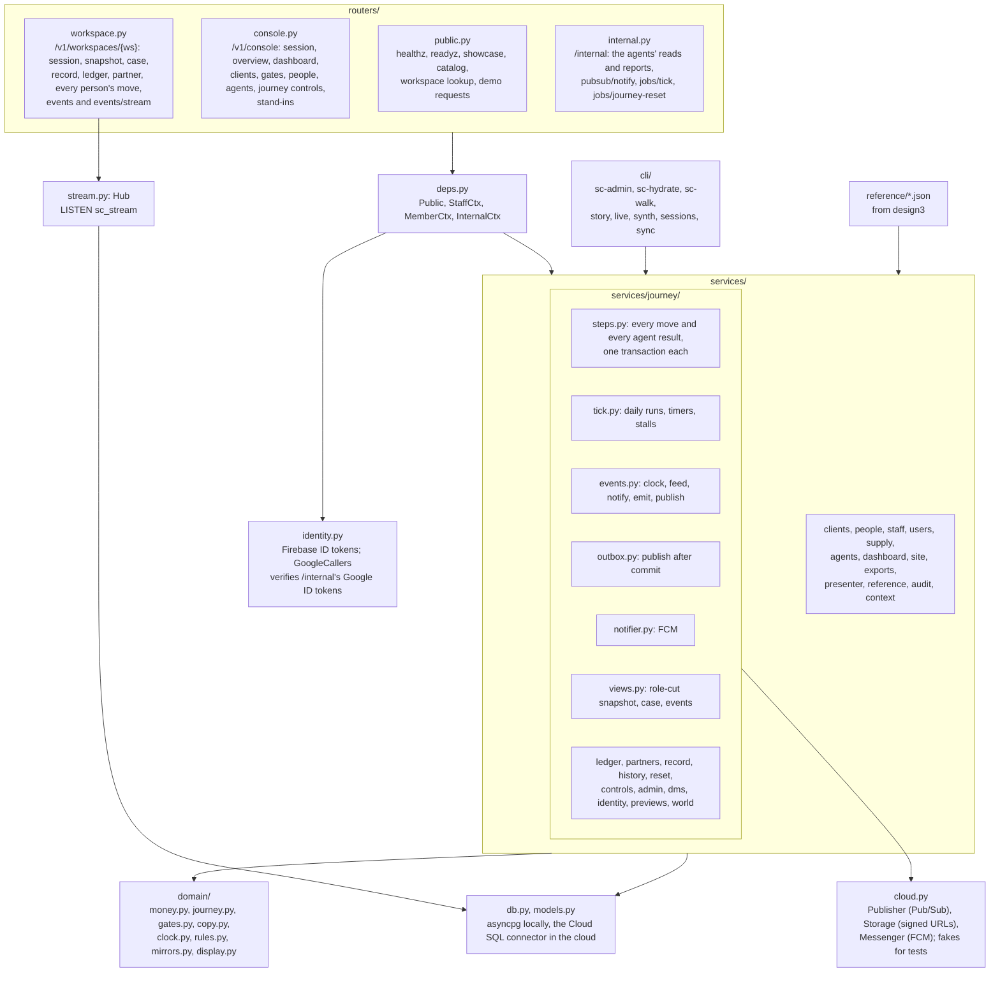

- **Four routers.** `public.py` serves the landing page. `console.py` serves staff under `/v1/console`. `workspace.py`
  serves a client's members under `/v1/workspaces/{ws}`. `internal.py` serves the agents, Pub/Sub's notify push and
  Cloud Scheduler, and is hidden from the OpenAPI schema. Errors are one JSON shape, `{ message, fields? }`.
- **Contexts.** `deps.py` turns a request into who is asking: `Public`, `StaffCtx` (an active staff member and their
  role's permissions), `MemberCtx` (a member of this workspace, their workspace role, and what their role may see),
  `InternalCtx` (a Google ID token whose verified email is one of `INTERNAL_CALLERS`).
- **Services are the only writers.** Each change is one transaction with its audit line, in the acting person's name
  and the prototype's words, carrying the request's trace id. The journey's services also write the timeline, the
  stream row, the notification and the outbox in that transaction.
- **`steps.py`** holds every person's move and every agent's result: the label photo, the approval, orders, bids,
  the staff sale, the donation, the truck, the van round, the papers, the review, expiry day, the destruction. Each
  step checks the case's phase first (`domain/journey.py` says what is allowed when) and is idempotent.
- **The views** cut every answer by role (`views.py`): a buyer never sees the reserve or the plan; a distributor sees
  his own batches, papers and copies; a kirana its own offers and orders; a food bank its own pickups.
- **Previews** (`previews.py`) are the figures an agent will write about, computed before it writes.
- **The domain** holds the ported rules: `money.py` (every figure, held to `money.js` by fixtures), `gates.py` (the
  quick-commerce gates, held to the SQL view), `journey.py` (the state machine), `copy.py` (every templated sentence),
  `clock.py` (the journey's clock).
- **The CLI** is how operators and the Cloud Run jobs reach the services: `sc-admin migrate` runs Alembic and loads
  the reference data; `sc-hydrate` builds the synthetic world and Munchly's live workspace through the services, and
  refuses any environment but local unless told its name (`--allow-env prod`); `sc-walk` walks a journey over HTTP;
  `sync` replaces production's data with local's.
- **Configuration** comes from the environment only: `SC_ENV`, `DB_MODE`, `DB_INSTANCE`, `DB_PASSWORD_SECRET`,
  `DEFAULT_PASSWORD_SECRET`, `SC_IMPERSONATE_SA`, `CORS_ORIGINS`, `STAFF_EMAIL_DOMAIN`, `WORKSPACE_DOMAIN`, `EVENTS_ENV`,
  the three bucket names, `INTERNAL_AUDIENCE` and `INTERNAL_CALLERS`, `NOTIFY_MODE`, `TICK_SECONDS`, the stream's
  limits, `LOG_FORMAT`, `TRACE_EXPORT` and `TRACE_SAMPLE_RATE`. A secret is named by its Secret Manager reference and
  read when first needed.

## 8. Events, time and the live stream

[](https://lucid.app/lucidchart/631bbb66-9b43-4e20-abf0-f44fa6a68174/view)

*Lucid: Smart-Clearance Google Cloud and AI, page 3.*

**The outbox.** A change and its events commit together. `events.publish` writes an `outbox` row in the change's
transaction, with the topic (`prod.` or `local.` before its name), an ordering key (`client:ref`, or `client`), and
attributes carrying the event id and the `traceparent`. `outbox.drain` publishes after the commit, from the route and
again from every tick, taking rows `FOR UPDATE SKIP LOCKED`. A failed key is held so a batch's events never overtake
each other.

| Topic | Published when | Read by |
| --- | --- | --- |
| `batch.at_risk` | the Watcher's report opens a case | the agents (Vision's photo request) |
| `offer.received` | a buyer bids or sends a message | the agents (the Negotiator) |
| `deal.closed` | a lot is awarded | the agents (the award price into BigQuery) |
| `journey.step` | the next stop, a daily run, a timer, Run now, an uploaded export, a receipt, a kirana's invoice, a destruction to check | the agents |
| `notify` | a member is to be told | backend-api's Notifier |
| `dead-letter` | five failed deliveries | held a week, and an alert |

In production, each agents topic has a push subscription to the agents service (`prod.agents.*`, ordered, a 600 s
acknowledgement deadline, OIDC as `sc-invoker`), and `prod.notify.api` pushes to backend-api's
`/internal/pubsub/notify`. Every subscription retries with backoff from 10 to 600 s. Locally the same topics have
pull subscriptions, which the agents' worker and the API's own puller read.

**Time.** A journey runs on its client's clock. `clients.day_minutes` sets how long a journey day lasts, from 1 to
1,440 minutes (real time), from the console. A synthetic workspace replays the story's own calendar.
Cloud Scheduler's `sc-tick` posts to `/internal/jobs/tick` every minute (locally, `TICK_SECONDS` runs the same loop).
For each client in a journey, the tick:

- runs the day's agents when they fall due: the Data agent at 08:30 and the Watcher at 09:00, journey time;
- fires due timers: `offer.close` (the kiranas' window), `listing.close` (an unsold lot), `report.due` (best-before),
  `destruction.remind`;
- re-sends a journey stalled for ten minutes;
- drains the outbox, and purges idempotency keys older than a day.

The console fires any of these at once and resets a journey. A daily run fired early is that day's run. On a
synthetic workspace the console also stands in for the partners: it fills an open kirana scheme as the story has it,
each shop ordering as itself with its own tax invoice
(`POST /v1/console/clients/{client_id}/journey/stand-ins/{stand_in_id}`).

**The live stream.** `events.emit` adds a `stream` row (one sequence a client, with its audience) and calls
`pg_notify('sc_stream', ...)`. `stream.Hub` listens, and falls back to polling every 2 s.
`GET /v1/workspaces/{ws}/events/stream` serves server-sent events: it resumes from `Last-Event-ID`, starts with
`retry: 3000`, sends a heartbeat every 20 s, and ends after 15 minutes with `event: end`, so Cloud Run's request
timeout (an hour) is never reached. The event types are `case`, `workspace`, `ledger` (the operator and the admin),
`feed`, `notification` (that member), `reset` and `end`. The app's client (`@smart-clearance/api/workspace`) uses SSE
while someone is using the app and polls `GET /events` every 30 s when idle. It falls back to polling after three
failed opens, and treats 45 s of silence as a dead stream.

**Pushes.** `events.notify` writes the notification row, emits it on the stream, and publishes `notify`. The Notifier
sends an FCM data message (web push, high urgency, a day's TTL) to every device the member's user has registered
(`POST /devices` from the PWA). A token FCM says is gone is deleted. A refusal is logged, and an alert watches for
them.

## 9. The data

[](https://lucid.app/lucidchart/631bbb66-9b43-4e20-abf0-f44fa6a68174/view)

*Lucid: Smart-Clearance Google Cloud and AI, page 4.*

### Cloud SQL, the system of record

One database, `smart_clearance`, schema `sc`: 37 tables and one view, migrated by Alembic as `sc_owner`. The API
logs in as `sc_app`, which has DML only and may not write reference data. The audit log refuses UPDATE, DELETE and
TRUNCATE by trigger, even to the owner.

The platform and its clients:

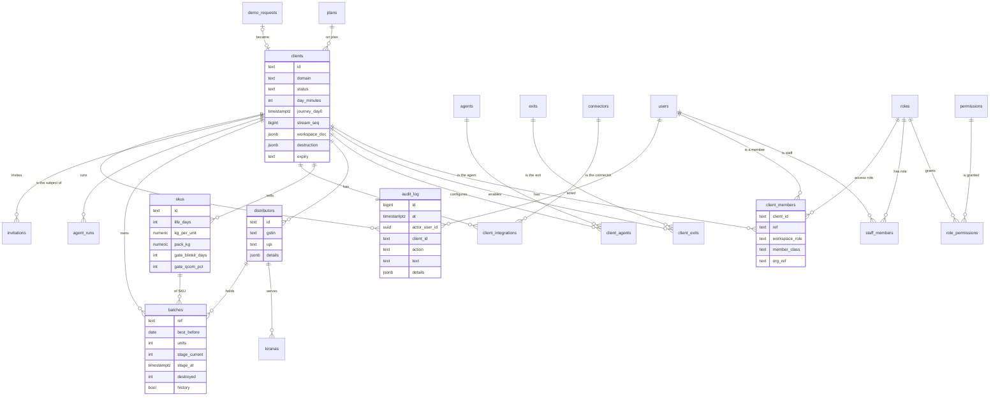

A batch's journey:

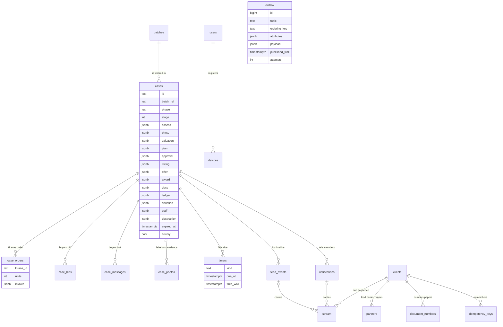

| Group | Tables | Notes |
| --- | --- | --- |
| Reference, loaded at migrate time | `plans`, `agents`, `connectors`, `exits`, `roles`, `permissions`, `role_permissions`, `documents` | from `src/sc_api/reference/`, which `seed.mjs` writes from design3; `rbac.json` by hand |
| People | `users`, `staff_members`, `client_members`, `invitations` | one `users` row a person, with the Firebase uid; a member has an access role and a workspace role |
| Clients and supply | `clients`, `client_exits`, `client_agents`, `distributors`, `skus`, `client_integrations`, `kiranas`, `partners`, `document_numbers` | a client's gates, rules, clock, expiry policy and destruction settings are typed columns or JSON; each party's identity (GSTIN, PAN, FSSAI, bank) |
| Activity | `demo_requests`, `agent_runs`, `batches`, `audit_log` | `batches.stage_at` is when a batch reached its stop; `destroyed` what it destroyed |
| The journey | `cases`, `case_orders`, `case_bids`, `case_messages`, `case_photos`, `timers`, `feed_events`, `notifications` | one open case a batch; the case keeps each stop's result as JSON, so the views read one row |
| Delivery | `stream`, `devices`, `idempotency_keys`, `outbox` | the live stream's sequence, FCM tokens, idempotent changes, events waiting to be published |
| For the agents | the view `batch_gates` | every open batch's quick-commerce gates, where each came from (override, SKU or client), and pass or fail |

**Migrations**, in order:

| Revision | What it adds |
| --- | --- |
| 0001 `baseline` | 22 tables, `sc_owner` and `sc_app`, the audit log's triggers |
| 0002 `sku_batch_gates` | SKU and batch gates, best-before, overrides, the view `batch_gates` |
| 0003 `batch_stage_at` | `batches.stage_at` |
| 0004 `workspace_journey` | the journey's 14 tables, the clock and stream columns, `workspace_doc` |
| 0005 `idempotency_keys` | `idempotency_keys` |
| 0006 `case_staff_sale` | `cases.staff` |
| 0007 `distributor_upi` | `distributors.upi` |
| 0008 `case_expired_at` | `cases.expired_at` |
| 0009 `history` | `history` on cases and batches |
| 0010 `sku_pack_kg` | `skus.pack_kg`, plastic packaging |
| 0011 `destruction_at_godown` | `destruction` on clients and cases, the `godown` policy |
| 0012 `batch_destroyed` | `batches.destroyed` |
| 0013 `web_app_addresses` | each client's address moved to `*-smartclearance.web.app` |
| 0014 `party_identity` | distributors' PAN, state code, FSSAI licence, email and bank |
| 0015 `kirana_invoices` | `case_orders.invoice` |

**The rules that live in two or three places**, held together by fixtures: the money (`design3/core/money.js`,
`backend-api/domain/money.py`, core's stub), the console's rules and the gates (`platform.js`, `platform.ts`,
`rules.py` and `gates.py` with the SQL view), the ledger and the partners' views (`ledger.js`, `ledger.py`,
`partners.py`, core's `ledger.ts`, `partners.ts`, `dist.ts`, `record.ts`), the GST papers (`papers.js`, core's
`papers.ts`, the agents' `tools/papers.py`).

**The dashboard and the ledger store nothing new.** The console's Overview and the workspace's
ledger are aggregates over `batches`, `cases`, `agent_runs` and `clients`, worked out at read time.

### BigQuery

Datasets `smartclearance` (production) and `smartclearance_local`, day-partitioned, written only by the agents.

| Table | What it holds |
| --- | --- |
| `stock_snapshots`, `secondary_sales` | the distributors' exports, as load jobs, never loaded twice |
| `channel_prices` | list prices, the kiranas' offers and the awards |
| `impact_ledger` | a row an exit when a batch reports |
| `agent_runs` | model, tokens, latency, fallback and trace for every run; partitions expire after 90 days |
| `agent_evals` | every eval case's result |
| `shelf_counts` | unused since the shelf check was retired |

### Cloud Storage

Three private buckets per environment, `aibuilder-510213-sc-{photos,docs,exports}-{prod,local}`, with public access
prevention enforced. Every object is opened through a short-lived signed URL that backend-api makes, after it has
checked the member may see it.

| Bucket | What it holds | Kept |
| --- | --- | --- |
| photos | label photos straight from phones, and the destruction's evidence; Vision reads them | for good: a batch's Record shows them |
| docs | Paperwork's PDFs | for good |
| exports | the distributors' DMS exports (CSV), which the Data agent loads into BigQuery | 30 days |

## 10. The frontend

Four apps, each built and deployed on its own, over three shared packages. What the apps share lives in a package,
never in a copy.

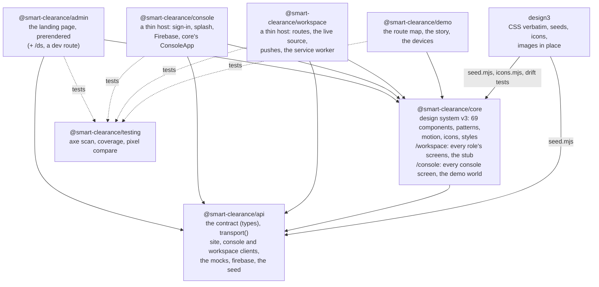

| Package | What it holds |
| --- | --- |
| `core` | the kit (`ThemeProvider`, `Shell`, `Page`, `DataTable`, `Sheet`, `Menu`, `Button` with its waiting states, `Tracker`, `Photo`, `Roll` …); `firstpaint` (stylesheets that never block the first paint); `/workspace`: `WorkspaceApp`, `RoleApp`, every role's 141 screens, `source.ts` (the `WorkspaceSource` both sources implement), the stub (`store.svelte.ts`, `flow.ts`) and the logic held to design3 (`partners.ts`, `dist.ts`, `record.ts`, `ledger.ts`, `papers.ts`, `impact.ts`); `/console`: `ConsoleApp` and its screens; `/console/demo`, the demo world |
| `api` | the contract in `src/types/` (`site.ts`, `console.ts`, `workspace.ts`, `shared.ts`), `transport()` with its `traceparent`; `siteHttp`/`siteMock`; `consoleHttp`/`consoleMock`/`demoConsoleApi`; `/workspace`: `workspaceHttp` (idempotency keys, a fresh token on a 401), `workspaceEvents` (SSE and polling), `putUpload` (signed URLs); `/firebase` (Auth and Messaging) |
| `admin` | `src/lib/landing/`: the bar, the hero film, the statement, the scene, the chapters, the ledger, the workspace section, plans, the close, the demo film's theatre; `hooks.server.ts` inlines design3's loader |
| `console` | one catch-all route rendering core's console; `hooks.server.ts` inlines design3's splash ahead of non-blocking stylesheets |
| `workspace` | `[[screen]]/[[ref]]` routes; `src/lib/live/` (`project.ts` projects backend-api's answers onto the screens' shapes, `source.svelte.ts` the live source, `push.svelte.ts` FCM); the manifest and service worker; aliases that drop the stub and the story's photos from a live build |
| `demo` | `story.ts` (the four lines, their stations and beats, held to `design3/demo/story.jsx`), the player, the route map, the devices running core's real screens |
| `testing` | `a11y.ts`, `a11y-coverage.ts`, `parity.ts`, `design3-server.py` |

### Rendering and data

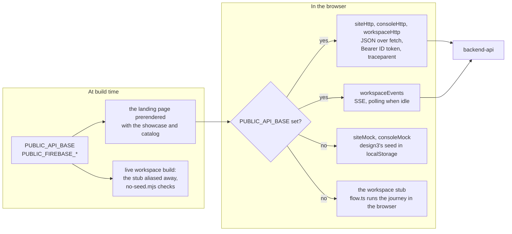

- **The landing page** is prerendered with its data, so it is complete without JavaScript. It names no client
 ; the demo film plays only when Watch is pressed, from YouTube.
- **The console** is a client-side app behind the staff sign-in, its screens in core so the guided demo can embed
  them. Its splash covers the first load, signing in and signing out.
- **The workspace app** reads a `WorkspaceSource`: the stub, or the live source over backend-api. The screens never
  know which. The live source projects the contract's shapes onto the screens' shapes, sends a step and shows it once
  it has gone through, and keeps the screens current from the stream.
- **The workspace app is a progressive web app.** It installs from the browser on Android, iOS and the desktop, with
  its own icon and full screen; its service worker keeps an offline shell and receives the pushes; it takes the label,
  evidence and receipt photos with the device's own camera, and its signing pad takes a finger, a stylus or a mouse.
  The same screens are laid out from 390 to 1,440 px wide.
- **The guided demo** runs the workspace's stub and the console's demo world in the browser; nothing is called and
  nothing is kept.
- **Every app keeps one `app.html`**, held identical by a test; environment variables are declared in each app's
  `src/env.ts`.
- **A design change is made in design3 first, then ported.** Drift tests fail when ported CSS leaves design3 outside
  marked `@port` blocks; `seed:check` and `icons:check` fail when generated files are stale.

## 11. The design prototypes, design3

design3 is the source of truth for every design. Its pages are the design system, the guided demo, the workspace app,
the landing page and the console, all built from one kit and one dataset. `demo/`, `app/`, `console/` and `site/`
reach `core/`, `screens/` and `system/` through symlinks, so a change there affects every page.

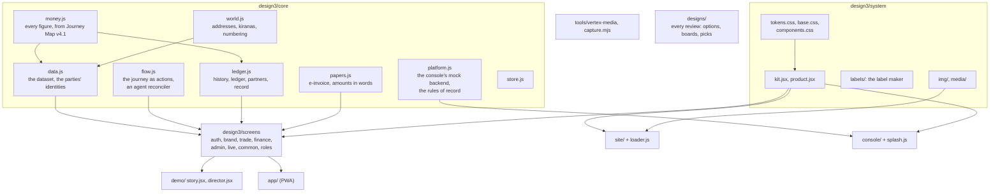

Three things flow from design3 into production, and tests hold them there:

- **The frontend** ports design3 page by page: the CSS verbatim, the seeds and the icon registry generated, and the
  parity suites comparing each build with the prototype pixel by pixel.
- **backend-api** loads design3's data as reference data (`seed.mjs` writes `src/sc_api/reference/`) and holds its
  Python rules to fixtures taken from `money.js`, `platform.js`, `flow.js` and `ledger.js`.
- **The agents' eval set** for Vision is printed by design3's label maker.

Every design review is kept in `design3/designs/`: the options, comps, recordings, the review board and the pick.
Only the picked option is built.

## 12. Identity, secrets and security

[](https://lucid.app/lucidchart/631bbb66-9b43-4e20-abf0-f44fa6a68174/view)

*Lucid: Smart-Clearance Google Cloud and AI, page 5.*

| Who acts | Signs as | May |
| --- | --- | --- |
| A member in an app | a Firebase ID token (email and password) | what their role allows, through a view cut to that role |
| Staff in the console | a Firebase ID token | what `rbac.json` gives their staff role |
| Cloud Scheduler, Pub/Sub | `sc-invoker`, an OIDC token for a fixed audience | call the tick, the notify push and the agents; Cloud Run lets nobody else in |
| The agents | `sc-agents`, a Google ID token for `sc-backend-api` | read facts and report on `/internal`; Gemini on Agent Platform, BigQuery, Cloud Storage; never PostgreSQL |
| backend-api, its jobs | `sc-api`, `sc-migrator` | IAM database logins (data as `sc_app`, the schema as its owner); secrets by reference; FCM sends |
| GitHub Actions on `main` | Workload Identity Federation: `github-backend` acts as `sc-builder`; `github-deployer` | start Cloud Build; release Hosting; nothing else |
| A developer's laptop | `sc-api-local`, `sc-agents-local`, impersonated in code from their own gcloud login | the real stack locally: the same user pool, topics and buckets, a local PostgreSQL |

- **No key exists.** No service account has a key, and no Google credential is a GitHub secret. Locally the API and
  the agents impersonate their `-local` accounts in code; never through `gcloud auth application-default login
  --impersonate-service-account`, which Terraform would then run as.
- **Secrets** live in Secret Manager only: the default user password and two local database passwords. Terraform makes
  the containers; a script fills them on stdin; the API reads them by reference. In the cloud there is no database
  password at all: Cloud SQL takes IAM logins only, through the connector, over TLS, with no authorised network.
  gitleaks scans every pull request, with one allowance in `.gitleaks.toml` for the fictional pollution-board
  authorisations.
- **Sign-in** is Firebase email and password with sign-up disabled, so only the API makes accounts, each on the
  default password an operator hands over. No email is ever sent. Every wrong sign-in answers the same (enumeration
  protection). The policy is 12 or more characters with mixed case and a digit. Staff sign in on the staff email
  domain; Munchly's people on `@munchly.example`, everyone outside Munchly on `@google.example`.
- **Authorisation** is in the API. `reference/rbac.json` has 28 permissions and 13 roles: three staff roles
  (`super-admin`, `platform-engineer`, `support`), four access roles, and six workspace roles (`ws-operator`,
  `ws-distributor`, `ws-retailer`, `ws-buyer`, `ws-foodbank`, `ws-admin`). A console route without an active staff member is a
  401, a workspace route without a member of that workspace a 403, and a refusal by role a 403 with a plain message.
- **`/internal`** takes only a Google ID token for its audience whose verified email is in `INTERNAL_CALLERS`
  (`sc-agents`, `sc-agents-local`, `sc-invoker`). The agents service has internal ingress, and only `sc-invoker` may
  invoke it.
- **Edges.** CORS allows only the Hosting sites in production (and the dev ports locally). Every API answer is
  `no-store` and `nosniff`. The workspace lookup is a POST, rate-limited, and names the workspace only. The console,
  the workspace and the demo send `noindex`, `X-Frame-Options: DENY` and a strict referrer policy. The console's
  browser key may call only the Identity Toolkit and Secure Token APIs, and the workspace's those and FCM's
  installations and registrations, each from its own app's origins. The buckets' CORS admits
  only the apps that upload to them.
- **The audit log** is append-only, by grants and by triggers that refuse UPDATE, DELETE and TRUNCATE even to the
  owner, and each row carries its request's trace.
- **Deletion protection** is kept in state on the state bucket, the billing link, the Hosting sites, the secret
  containers, the Cloud SQL instance, both Cloud Run services and the jobs, and production's BigQuery tables.

## 13. The cloud runtime

[](https://lucid.app/lucidchart/631bbb66-9b43-4e20-abf0-f44fa6a68174/view)

*Lucid: Smart-Clearance Google Cloud and AI, page 2.*

| Resource | Settings |
| --- | --- |
| Cloud Run `backend-api` | public ingress, as `sc-api`; 0 to 2 instances, 1 vCPU, 512 MiB; an hour's request timeout, for the live stream; probes on `/healthz`, readiness on `/readyz` (Cloud Run reserves `/healthz` on the public address) |
| Cloud Run `agents` | internal ingress, as `sc-agents`, invoked only by `sc-invoker`; 0 to 2 instances, 1 vCPU, 1 GiB, CPU only while serving, startup boost; 600 s, a whole run inside each push; a startup probe on `/readyz` |
| Cloud Run jobs | `backend-api-migrate` (Alembic as `sc-migrator`, before every deploy) and `backend-api-hydrate` (the synthetic world and Munchly's live workspace, through the services), both on the API's image |
| Cloud SQL `sc-main` | PostgreSQL 18, Enterprise, `db-f1-micro`, zonal, 10 GB SSD; IAM authentication only; seven backups and seven days of point-in-time recovery; Query Insights |
| Pub/Sub | five topics and a dead letter for each environment; ordered push subscriptions in production, pull subscriptions locally |
| Cloud Scheduler | `sc-tick` every minute (Asia/Kolkata); `sc-journey-reset` daily at 07:30, paused |
| BigQuery | `smartclearance` and `smartclearance_local`, seven tables each |
| Cloud Storage | the photos, docs and exports buckets of each environment; the builds bucket (sources, emptied after 7 days) |
| Artifact Registry `sc` | the backend-api and agents images, tagged with their commit |
| Monitoring | an uptime check on `/readyz` every five minutes from three regions; 11 alert policies (the API down, 5xx, slow, logged errors; Cloud SQL CPU, memory and disk; dead letters, the agents' 5xx, the agents' fallbacks over a quarter of runs, FCM refusals); a dashboard; log-based metrics for agent runs and push failures |
| Budget | GBP 30 a month, emailing at 50%, 90%, 100% and on a forecast overrun |

Everything is Terraform in `infra/`, in two roots: `bootstrap/` (the state bucket, holding its own state) and `prod/`
(everything else, for both environments). What was made by hand first (the billing link) is adopted by an `import`
block.

| File in `infra/prod` | What it holds |
| --- | --- |
| `project.tf`, `providers.tf`, `versions.tf`, `variables.tf`, `outputs.tf` | the billing link and about 25 APIs, the providers, the GCS backend, the inputs and outputs |
| `hosting.tf` | Firebase on the project; a Hosting site per app (`smartclearance`, `smartclearance-console`, `munchly-smartclearance`, `smartclearance-demo`) |
| `auth.tf` | Identity Platform; the console's and the workspace's Firebase web apps and restricted browser keys |
| `backend.tf` | `sc-api-local`; the `scAuthUsers` and FCM-sending custom roles |
| `secrets.tf` | the three secret containers |
| `sql.tf`, `run.tf`, `registry.tf`, `build.tf` | Cloud SQL, `sc-api`, `sc-migrator`, the service and jobs, Artifact Registry, Cloud Build's `sc-builder`, `github-backend` and the builds bucket |
| `agents.tf` | `sc-agents`, `sc-agents-local`, `sc-invoker`, and the agents service |
| `events.tf`, `scheduler.tf` | the topics, subscriptions and dead letters; the two Scheduler jobs |
| `analytics.tf`, `bigquery/*.json` | the datasets and the seven tables' schemas |
| `storage.tf` | the six app buckets, their CORS and the exports' lifecycle |
| `deployer.tf`, `github.tf` | the Workload Identity pool and provider; `github-deployer`; the repository's `prod` environment and variables |
| `monitoring.tf`, `budget.tf` | the alerts, the uptime check, the dashboard, the metrics; the budget |

Three switches stage the runtime, each needing the one before: `backend_runtime` (Cloud SQL and the API),
`agents_runtime` (the agents, the push subscriptions, Scheduler) and `workspace_live` (the workspace app built against
the API). All three are on.

**Cost:** about ₹1,350 a month with light use and ₹3,600 with heavy use, nearly all Cloud SQL and Gemini; everything
else sits in free tiers at the prototype's traffic. [Performance, cost and scale](#17-performance-cost-and-scale) has
the breakdown.

## 14. Delivery: CI, builds and deploys

[](https://lucid.app/lucidchart/0e33214e-b46f-4cfb-9413-b2c40de7d1c6/view)

*Lucid: Smart-Clearance Architecture on Google Cloud, page 3.*

`.github/workflows/ci.yml` runs on pull requests to `main`, on pushes to `main` and by hand, for changes to the
frontend, design3 (not its `designs/`), `infra/`, `backend-api/`, `agents/` or the workflow.

| Job | When | What it does |
| --- | --- | --- |
| Frontend gate | always | ESLint, Prettier, svelte-check, Vitest, `seed:check`, `icons:check` |
| Infra gate | always | `terraform fmt` and `validate`, `bash -n`, shellcheck |
| Backend gate | always | ruff, pytest on a `postgres:18` service |
| Agents gate | always | ruff, shellcheck, pytest on the stub tier (Python 3.14 and 3.13) |
| Secret scan | always | gitleaks 8.30, checksum-verified, over the commit range |
| Build | always | every app once, with the production settings; the live workspace build checked by `no-seed.mjs`; kept as an artifact |
| Backend | `main`, if `backend-api/` changed | as `github-backend`: Cloud Build pulls the last image for its cache, builds and pushes `:commit` and `:latest`, runs `backend-api-migrate`, moves the hydrate job to the image, updates the service, and checks `/readyz` |
| Agents | `main`, if `agents/` changed, after Backend | Cloud Build builds and pushes the agents' image and updates the internal service |
| Deploy | `main`, after both | as `github-deployer`: `deploy.sh` releases the build artifact to the four Hosting sites and checks each answers 200 |

- Only `main` may deploy, through the GitHub environment `prod`; deploys queue rather than overlap, and a newer push
  to a pull request cancels its older run.
- Every action is pinned to a commit SHA, the workflow token is read-only, and only the three deploying jobs get
  `id-token: write`.
- Cloud Build owns the Cloud Run images; Terraform ignores them. Terraform runs from a workstation, as a person: plan
  to a file, read the whole plan, apply that file. CI checks the configuration but never plans or applies.
- A contract change deploys the API first, since the landing page's build prerenders against the live API.

## 15. Local development

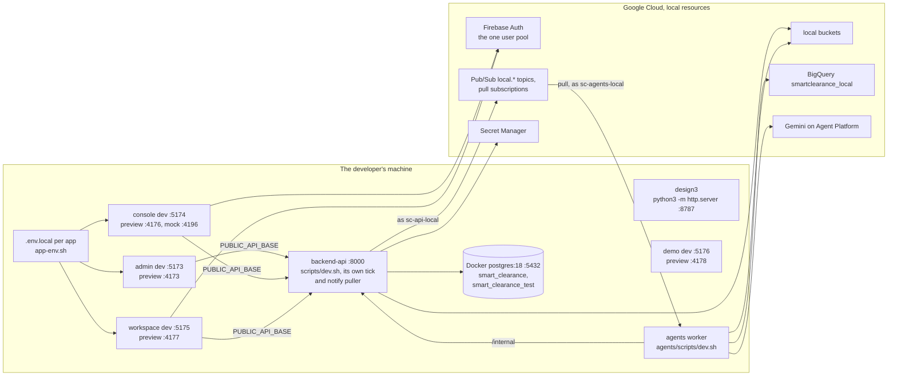

- **Without Google**, every app runs on its mocks or the stub, seeded from design3; nothing else is needed.
- **The real stack locally** is the same code against a local PostgreSQL and the `local` resources in the cloud: the
  same Firebase user pool, the `local.*` topics with pull subscriptions, the `-local` buckets, `smartclearance_local`
  and live Gemini. The API runs its own tick (`TICK_SECONDS`) and pulls `local.notify.api` (`NOTIFY_MODE=pull`).
- **Scripts do every step** in `backend-api/scripts/` (doctor, secrets, db-init, migrate, hydrate, dev, up, app-env,
  default-password, test, e2e, walk, live-fixtures, sessions, sync, contracts, bootstrap) and `agents/scripts/` (dev,
  test, eval, eval-harvest, smoke). They read the project and region from `infra/prod/terraform.tfvars`.
- **Pango** must be installed for the local Paperwork agent to render PDFs (`brew install pango` on a Mac); the
  agents' image has it.
- **Parallel sessions share** the test database and the local Pub/Sub subscriptions; one worker at a time should read
  them.

## 16. Testing and quality

[TESTING.md](TESTING.md) has every command, what each needs first, and which journeys to cover for which change.

| Layer | What runs | When |
| --- | --- | --- |
| Gates | frontend (lint, svelte-check, Vitest: core 408, workspace 115, api 86, admin 22, demo 9, console 2), backend-api (ruff, 583 pytest tests on a real PostgreSQL), agents (ruff, 225 pytest tests on the stub tier, every writer's recorded answers replayed), infra (`check.sh`), gitleaks | every pull request, and before every commit |
| Held to design3 | drift tests (CSS verbatim), seed and icon checks, fixtures from `money.js`, `platform.js`, `flow.js`, `ledger.js`, `papers.js`; core's goldens of every role's screens | in the gates |
| Live, in jsdom | the workspace's live tests on what backend-api answered at fixed moments of the journey (`live-fixtures.sh`) | in the gates |
| Browser suites | a11y (axe WCAG 2.2 AA in five projects, keyboard and motion specs, component coverage), e2e (each app's flows; Firefox and WebKit smoke), parity (each build against design3, pixel by pixel) | on request, outside CI |
| Live end to end | `backend-api/scripts/e2e.sh`: the landing page and the console on the local API and Firebase | on request |
| Journey suites | Munchly Chips, Mango, Chips Leftover, Mango Leftover and Chips Sad Path E2E, the Mango Drink on three screens, and the admin and console runs: every person in the real UI, recorded, against the local stack or production (`E2E_TARGET=prod`) | on request |
| Evals | the agents' seven sets on live Gemini | on request, about GBP 2 (₹260) |

The browser suites' last full run found 0 WCAG 2.2 AA violations in 352 checks over the four apps' builds, and passed
305 pixel comparisons with design3, each within 0.5%.

## 17. Performance, cost and scale

Measured on production between 8 and 10 October 2026: Cloud Run, Cloud SQL and BigQuery in `asia-south1`, and Gemini
on Agent Platform's global endpoint. Prices are Google's INR list prices for `asia-south1` on 10 October 2026.

| Measure | Result |
| --- | --- |
| An API call on Cloud Run | 102 ms at the median, 412 ms at p95, over 7,251 calls |
| An agent's decision on Gemini Pro | 8.7 s at the median; a Flash step takes 2 to 4 s |
| Gemini, a call | ₹0.06 to ₹0.50 |
| Gemini, a batch's whole journey | ₹1.70 for the Masala Chips, about 0.01% of the ₹21,152 it recovered |
| Cloud SQL on `db-f1-micro` | 27% CPU at its peak, 11% on average |
| The whole journey, recorded on production | 77 of 77 steps from a reset to the impact report, in 9 min 46 s |
| First paint on a 3G line (the builds) | the console 2.6 s (from 8.1 s); the landing page 2.4 s (from 6.4 s), its loader lifted at 7.8 s (from 14.6 s) |

**Each agent on production:** 784 agent runs and 257 Gemini calls, read from BigQuery's `agent_runs`. The 90th
percentile includes the retries on the Pro preview's shared quota.

| Agent | Model | Median | 90th percentile | ₹ a call |
| --- | --- | --- | --- | --- |
| Paperwork | Flash | 2.1 s | 5 s | 0.06 |
| Lister | Flash | 2.5 s | 17 s | 0.15 |
| Outreach | Flash | 3 s | 9.2 s | 0.22 |
| Vision | Flash | 4 s | 48.6 s | 0.34 |
| Negotiator | Pro | 5.6 s | 14.9 s | 0.15 |
| Valuer | Pro | 9.2 s | 26.6 s | 0.50 |
| Router | Pro | 10.8 s | 38.4 s | 0.26 |

Flash does the volume; Pro only the decisions a person approves.

**Running it, a month:**

| Service | What runs | ₹ a month |
| --- | --- | --- |
| Cloud SQL for PostgreSQL 18 | `db-f1-micro` (a shared vCPU, 0.6 GB) at ₹1.21 an hour, zonal; 10 GB SSD, backups, point-in-time recovery | 1,115 |
| Cloud Run | backend-api (1 vCPU, 512 MiB) and the agents (1 vCPU, 1 GiB), 0 to 2 instances, billed per request; most of it is the live stream while people use the app | 100 to 600 |
| Gemini on Agent Platform | Flash at ₹144 and ₹720 a million tokens in and out, Pro at ₹192 and ₹1,152; about ₹2 a batch's journey | 130 to 1,900 |
| Pub/Sub, Cloud Scheduler, BigQuery | the events, the minute's tick, the analytics tables | 0 |
| Firebase Hosting, Authentication, Cloud Messaging | four sites, one user pool, the pushes | 0 |
| Secret Manager, Cloud Build, Cloud Trace, Logging, Monitoring | the secrets, the releases, spans, JSON logs, alerts | 0 |
| **In all** | at the prototype's traffic, from light use to heavy | **1,350 to 3,600** |

The budget, GBP 30 (about ₹3,840), emails at 50%, 90% and 100%. A full eval run on live Gemini costs about ₹260 and
runs on request only.

**The free tiers it runs inside:** Cloud Run's 2 million requests and 180,000 vCPU-seconds a month; BigQuery's 1 TiB
of queries and 10 GiB stored; Pub/Sub's 10 GiB of messages; Cloud Scheduler's 3 jobs (it runs 2); Secret Manager's 6
secret versions; Cloud Trace's 2.5 million spans; Logging's 50 GiB; Cloud Build's 2,500 build-minutes; Firebase
Hosting, email sign-in and Cloud Messaging; GitHub Actions on a public repository. Every library in the stack is free
and open source.

**How it scales.** Each limit is a setting in Terraform. The Cloud SQL tier is the `db_tier` variable: `db-f1-micro`
at about ₹1,115 a month, `db-g1-small` at about ₹3,200, or 2 vCPU and 8 GB at about ₹11,900. Each Cloud Run service's
instance ceiling (2 today) is set in `run.tf` and `agents.tf`, and costs nothing until it is used. The agents are
stateless and a batch's events stay in order whatever the number of instances, so more instances need no other
change. For Gemini, Provisioned Throughput on Agent Platform would end the shared quota's 429s.

## 18. Observability: one request, one trace

Every API call the apps make starts a trace. Cloud Run keeps its id, backend-api continues it, the outbox
carries it into Pub/Sub's attributes, and the agents continue it again, so one tap can be followed from the browser to
Gemini and back.

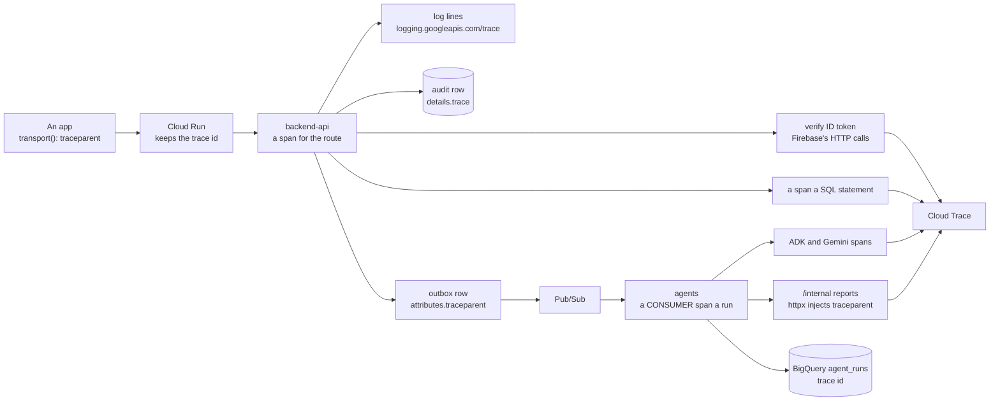

A request Cloud Run sampled is always traced; of the rest, a quarter (`trace_sample_rate`). An unsampled request still
has its trace id in its log lines, audit rows and agent runs. Spans go over OTLP to the Telemetry API
(`telemetry.googleapis.com`), read in Cloud Trace; Google's Python Cloud Trace exporter is deprecated, so it is not
used. Logs are one JSON object a line with severity and source (`LOG_FORMAT=json`), so Error Reporting groups stack
traces. A failed call's `ApiError` carries its trace id in the browser.

**One trace on production,** 10 October 2026, `134976f7785da3621103263c699520d3`: 7.28 s and 368 spans from Priya's
tap on Approve to the agents' work, 331 of them from backend-api and 32 from the agents, each Gemini call with its model
and tokens.

| Span | Time |
| --- | --- |
| Priya taps Approve (backend-api) | 0.77 s |
| the agents' `execute` pipeline | 6.89 s |
| loading the settings and the case | 0.81 s |
| the Lister on Gemini 3.8 Flash | 2.76 s |
| Outreach on Gemini 3.8 Flash | 2.40 s |
| Outreach reports the scheme | 3.47 s |
| the Lister reports the listing | 1.13 s |
| BigQuery's `agent_runs` | 0.17 s |

The same id is on the seven lines both services logged in Cloud Logging, on each agent run's row in BigQuery, and on
Priya's audit line in Cloud SQL ("approved the plan").

## 19. Accessibility and motion

The target is WCAG 2.2 AA, held by the frontend's a11y suite on each app's production build.

| Concern | How it is held |
| --- | --- |
| axe violations | zero, in five viewport and theme projects, on all four apps; a coverage check fails the run if an app uses a core component no scan had on screen |
| Keyboard | specs for the sign-ins, sheets and alerts taking and returning focus, menu buttons, form errors, the landing page's film and table, the workspace's one-time code and row menus, the demo's keys and route map |
| Motion (2.2.2) | every animation stops within five seconds, and `motion.a11y.spec.ts` fails on an endless one. The exceptions are loading indicators (the loader, the console's splash and placeholders, a button's spinner) and the hero film, which loops under its Pause |
| Reduced motion | every motion lands on its still frame at once |
| Contrast | measured against the pixels text actually sits on, including fills, tinted chips, plates and film, after any opacity |
| Live data | the console's readings can be paused; the workspace's live line is never announced on its own |
| Still manual | 2.4.11, 2.5.7, 3.2.6, 3.3.7 and 3.3.8 |

Motion is prototyped in Framer Motion in design3 and shipped in Svelte with `motion` and the same springs.

## 20. Decisions and their reasons

| Decision | Why |
| --- | --- |
| Design first, in design3, then port | one source of truth for designs, reviewed on a board before anything is built; tests hold the port to it |
| Static SvelteKit builds on Firebase Hosting | the apps are a prerendered page and client-side apps over an API; every byte is cacheable at the edge, and there is no rendering server to run |
| Firebase for hosting, sign-in and pushes; Cloud SQL for the record, not Firestore | relational truth with transactions across a change, its audit line and its outbox; SQL views the agents read; `LISTEN/NOTIFY` and SSE for the live screens |
| Only backend-api writes; the agents report to it | one place for every rule, an audit log complete by construction, and no database credentials outside the API |
| Gemini writes the words, backend-api computes the figures | money is never a model's guess; every figure is held to `money.js`; a model's sentence that quotes another figure is dropped |
| Two Gemini tiers | Pro where a person decides on the words (prices, the split, a counter); Flash where reading and drafting must be fast and cheap |
| Stateless ADK pipelines, one run an event | a run survives a cold start and a redelivery; nothing to resume; Pub/Sub's retries and dead letters do the rest |
| A state machine orchestrates; a table dispatches | the next step comes from code in backend-api and each event's pipeline from a fixed table, so the same facts always lead to the same steps; no model routes work |
| ADK workflow agents, no model-driven delegation | `SequentialAgent` and `ParallelAgent` give order and parallelism without a model picking the next agent; a writer cannot transfer |
| The agents on Cloud Run, not Agent Runtime | Pub/Sub pushes straight to them; they scale to zero beside backend-api, with one way to deploy, sign in, log and trace; backend-api is the record, so no managed sessions are needed |
| Gemini on Agent Platform, as a service account | no API key anywhere; the model ids are Terraform variables; Pro and Flash on the global endpoint, where the Gemini 3 models are served |
| An outbox, published after the commit | an event never leaves for a change that rolled back, and never goes missing for one that committed; ordering per batch |
| Cloud Scheduler for the clock | the journey moves on with every instance scaled to zero; the console can fire any timer at once |
| A journey day from 1 to 1,440 minutes | a demo can walk the whole story in an hour on the real stack |
| The stub and the live source behind one interface | the guided demo and the prototype keep working with no backend, and a live build carries none of the stub |
| Email and password for everyone, no email sent | one shared user pool; accounts made by the API on a default password an operator hands over |
| Secrets by reference, no keys, IAM database logins | nothing secret in a file, a command line, state or git |
| Cloud Run scaling to zero, `db-f1-micro` | about GBP 9 a month for the platform; a cold start is covered by the console's and the workspace's splash |
| The photos and papers kept for good, the exports for 30 days | a batch's Record and its PDFs are its evidence; the exports are loaded into BigQuery |
| Cloud Build releases the services; firebase-tools the apps; Terraform owns neither's content | the Hosting provider cannot upload files, and Cloud Build owns the image |
| Every Terraform plan saved, read in full, then applied | nothing in the cloud changes unread |
| OpenTelemetry over OTLP to the Telemetry API | Google's route into Cloud Trace; logs, audit rows and agent runs carry every request's trace, sampled or not |
| WCAG 2.2 AA with zero axe violations | held by suites on the real apps, not by review alone |

## 21. Known gaps

- **One user pool** serves local development and production, so the same accounts sign in to both.
- **Cold starts.** Cloud Run scales to zero, so the first request after a quiet spell waits a few seconds. Cloud SQL
  is a shared core without an SLA, and the rate limiter counts per instance.
- **No custom domain:** the apps live on Firebase Hosting's own addresses, and the staff email domain is
  `smartclearance.example`.
- **Terraform runs from a workstation;** CI checks it but never plans. The browser suites, the journey suites and the
  evals are not in CI.
- **Firefox** cannot start in the agent's sandboxed shell, so the e2e suite's Firefox run needs a normal machine.
- **The prototypes' hosted copies** run on their mocks and are pinned to older commits.
- **Traces:** the apps start a trace per API call, not per click; the migrate and hydrate jobs are not traced.
- **The agents:** `infra/prod/monitoring.tf` describes the model timeout as 20 s where the code gives 30 s an attempt;
  the `sc-agents-harvest` entry point names a module that does not exist (`eval-harvest.sh` is the working route); the
  Data eval set's summary predates the shelf cases' removal.
- **BigQuery's `shelf_counts`** and the `cases.shelf` column are unused since the shelf check was retired.
- **The WCAG 2.2 criteria axe cannot check** (2.4.11, 2.5.7, 3.2.6, 3.3.7, 3.3.8) await a manual pass.
- **The landing page** ships about 160 kB of JavaScript, gzipped; the console's first load on a slow line is bound by
  its code in waves.
- **The agents' autonomy levels** (suggest, ask, act) are set per client and audited, but the live journey does not
  read them yet: an agent is on or off, and the journey's two people's gates are fixed.
- **Gemini 3.1 Pro is a preview** on a shared quota, which answers 429 under load; each call retries, then falls back
  to its template. Provisioned Throughput, or Pro on general availability, would end it.
- **Reject** sits beside Approve on the plan, drawn but not built: a plan is approved or left waiting.

## 22. What comes next

| Area | Next |
| --- | --- |
| Integrations | WhatsApp Business for the kiranas' offers, beside the in-app push; partner APIs for near-expiry marketplaces; DMS connectors (Bizom, Tally) instead of nightly CSV exports; live e-invoicing (IRN) and e-way bills through a GST Suvidha Provider |
| The agents | reject and re-plan: a rejection's reason becomes a rule, and the Valuer and the Router come back with two or three new plans, each with its money; prices and splits learned from every closed deal; demand forecasting per pincode with BigQuery ML and Agent Platform; Gemini Pro on general availability; offers in Tamil, Telugu, Bengali and Kannada |
| The product | full-credit take-back beside destruction at the godown; native iOS and Android apps on the same API, with offline capture at the godown and background sync; pharma and OTC profiles under the Drugs and Cosmetics Rules |
| The platform | self-serve onboarding for manufacturers; an own domain and single sign-on; data residency for enterprise clients; Provisioned Throughput for Gemini; Cloud Run and Cloud SQL sized up through their Terraform settings |

## 23. The diagrams' sources

The twelve pictures above are exports of four Lucidchart documents. They open in Lucid for anyone the documents are
shared with.

| File | Lucid document | Page |
| --- | --- | --- |
| [`system.webp`](docs/architecture/system.webp) | [Smart-Clearance Architecture on Google Cloud](https://lucid.app/lucidchart/0e33214e-b46f-4cfb-9413-b2c40de7d1c6/view) | 1, Smart-Clearance on Google Cloud |
| [`agents-nine-stops.webp`](docs/architecture/agents-nine-stops.webp) | Architecture on Google Cloud | 2, Ten agents along nine stops |
| [`delivery.webp`](docs/architecture/delivery.webp) | Architecture on Google Cloud | 3, GitHub Actions and Cloud Build |
| [`cloud-layers.webp`](docs/architecture/cloud-layers.webp) | [Smart-Clearance Google Cloud and AI](https://lucid.app/lucidchart/631bbb66-9b43-4e20-abf0-f44fa6a68174/view) | 1, Google Cloud, layer by layer |
| [`cloud-run.webp`](docs/architecture/cloud-run.webp) | Google Cloud and AI | 2, Cloud Run |
| [`events-and-time.webp`](docs/architecture/events-and-time.webp) | Google Cloud and AI | 3, Pub/Sub and Cloud Scheduler |
| [`data.webp`](docs/architecture/data.webp) | Google Cloud and AI | 4, Where the data lives |
| [`identity.webp`](docs/architecture/identity.webp) | Google Cloud and AI | 5, Who signs as whom |
| [`agents-and-models.webp`](docs/architecture/agents-and-models.webp) | Google Cloud and AI | 6, The agents and their models |
| [`model-call.webp`](docs/architecture/model-call.webp) | Google Cloud and AI | 7, A model call, bounded |
| [`flow-core-loop.webp`](docs/architecture/flow-core-loop.webp) | [Application Flow · the core loop](https://lucid.app/lucidchart/2965aa52-3190-4d68-8791-9c95c8fd7bbc/view) | 1 |
| [`flow-batch-journey.webp`](docs/architecture/flow-batch-journey.webp) | [Application Flow · a batch's journey](https://lucid.app/lucidchart/c2efb94b-7aa2-4cc1-a6cc-af4980ff255f/view) | 1 |

**To refresh one**, edit it in Lucid, export the page as PNG (Lucid's export, or the Lucid connector's
`lucid_export_document_as_PNG`), and convert it losslessly under the same name:

```bash
cwebp -lossless -z 9 page.png -o docs/architecture/<name>.webp
```

The same three Google Cloud pages are kept for draw.io in `docs/smart-clearance-architecture.drawio`, and the
architecture page and its PDF (`docs/smart-clearance-architecture.html`, `.pdf`) carry them for the submission.
