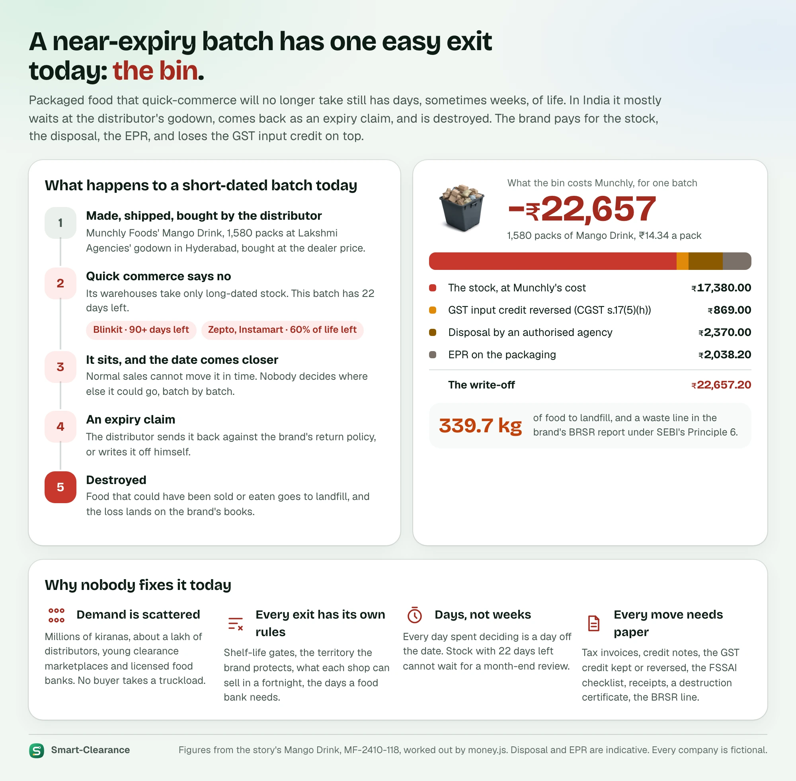
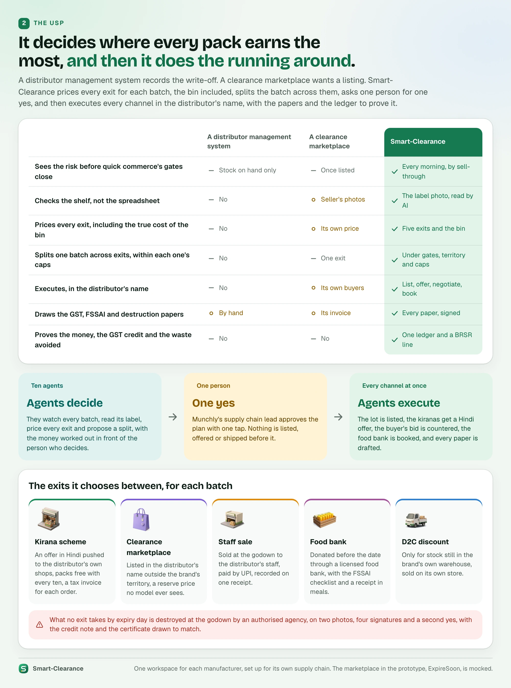
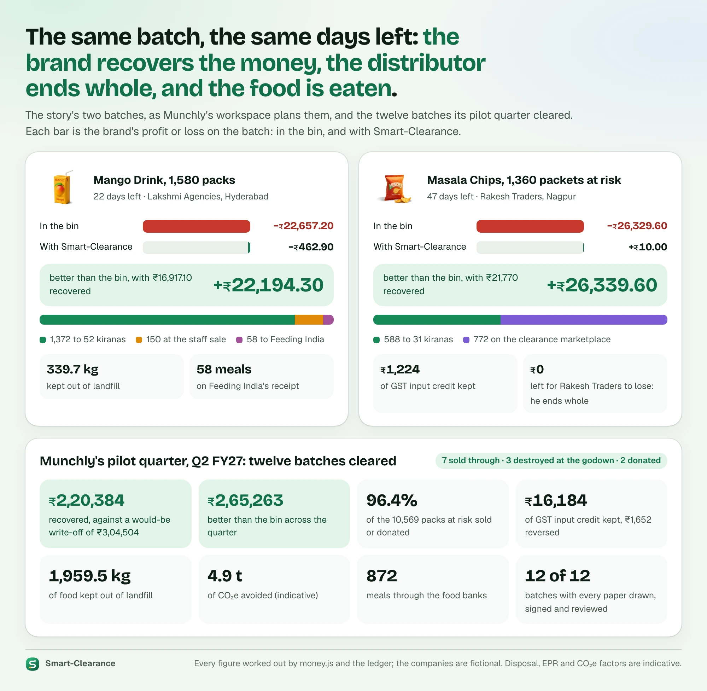

# Product

<!-- impeccable:product-schema 1 -->

## Why Smart-Clearance: the problem, the USP and the agentic answer

**In one line:** Smart-Clearance turns a near-expiry batch from a write-off into money recovered. Ten agents on Google
Cloud find it in time, check it on the shelf, price every exit including the bin, and split it across them. One person
says yes with the money in front of them. Then the agents do the running around in the distributor's name, and they
draw every paper and post every rupee and kilo to one ledger.

It starts with a rule: what the law and the quick-commerce apps demand of a pack's remaining life. The four pictures
after it tell the rest with the story's own figures, each worked out by `design3/core/money.js` and the ledger. Their
sources are in `docs/product/source/` (`node docs/product/source/render.mjs` draws them again).

### 1. The rule that starts it: FSSAI's shelf-life floor, and the apps' stricter gates

**The law.** FSSAI, India's food regulator, directed e-commerce food businesses in November 2024 that packaged food
must reach the consumer with **at least 30% of its shelf life, or 45 days, left before expiry** at the time of
delivery ([All India Radio](https://www.newsonair.gov.in/fssai-directs-e-commerce-fbos-to-ensure-minimum-30-shelf-life-for-delivered-products-to-enhance-food-safety-standards),
[Outlook Business](https://www.outlookbusiness.com/news/fssai-directs-online-platforms-to-deliver-food-items-with-minimum-45-day-shelf-life)).
Food ordered from restaurants and caterers is outside it: that must simply be fresh. The direction states the two
figures without saying which wins. Explainers read it as a sliding floor, the 45 days binding on long-life food and 30%
on short-life food:

| Food | Shelf life | The floor that binds | Left at delivery, at least |
| --- | --- | --- | --- |
| Fresh paneer, curd, artisanal butter | 10 days | 30% (45 days is longer than the whole life) | 3 days |
| Biscuits, chips, packaged spices | 120 days | 45 days (30% would be 36) | 45 days |
| The story's Masala Chips | 184 days | 30% is 55 days, so 55 if the longer figure binds | 45 to 55 days |
| Canned food, premium ghee | 360 days | 30% is 108 days, if the longer figure binds | 45 to 108 days |

Some guides read "whichever is longer", which gives the longer floors above; on that reading a 10-day product could
never be sold online at all, which is why the sliding reading is the usual one. Either way, the floor is set at the
consumer's door, after the warehouse, the dark store and the delivery have all taken their days.

**The apps' stricter gates.** Because their dark stores turn stock in days and cannot risk delivering below that floor,
the quick-commerce apps take stock from brands only with far more life left. As industry guides report them (not the
platforms' own documents, and they differ):

- **Zepto and Swiggy Instamart:** about **60% of the total shelf life** left at inwarding; stock below it is turned away
  at the warehouse ([Confetti](https://confetti.design/blog/quick-commerce-readiness-checklist),
  [CollegeDekho](https://www.collegedekho.com/articles/how-to-get-featured-on-zeptos-superfast-delivery-a-founders-guide-to-dark-store-allocation/)).
- **Blinkit:** a fixed **90 to 120 days** left, by one checklist ([Confetti](https://confetti.design/blog/quick-commerce-readiness-checklist));
  another describes it as 60% of life or more ([SW Cybernetics](https://swcybernetics.in/knowledge-base/blinkit-vs-zepto-vs-instamart-comparison-2026)).

Smart-Clearance takes these as the client's settings, not as constants: Munchly's defaults are Blinkit 90 days and Zepto
and Instamart 60% of life, and each SKU and each batch can carry its own.

**What follows for brands and distributors.**

- **Stock is shut out months before its date.** A 184-day snack is refused by Zepto and Instamart once it has less than
  110 days left, and by Blinkit at 90. The rest of its life is spent in the distributor's godown, where normal sales
  cannot clear it, and it comes back as an expiry claim.
- **First expiry, first out.** Dark stores must rotate by expiry date (FEFO), not by arrival (FIFO), to avoid delivering
  below the floor, so a short-dated batch is the first thing a platform stops taking.
- **Dates on the listing are coming.** FSSAI is drafting rules to require the manufacturing date, expiry date and batch
  number on quick-commerce listings, and to hold the platforms answerable for misleading label claims; as of October
  2026 these are proposals, not notified rules, and FSSAI has said listing declarations also fall under the Department
  of Consumer Affairs' rules ([Inc42](https://inc42.com/buzz/fssai-eyes-tighter-quick-commerce-rules-for-expiry-dates-food-labelling/),
  [Business Standard](https://www.business-standard.com/industry/news/fssai-says-expiry-date-display-on-e-commerce-platforms-under-dca-rules-126062300948_1.html)).
  Once in force, a batch's real dates will be visible to every buyer, and stock near its date will be harder still to
  sell online.
- **The write-off is the brand's.** What no channel moves in time is written off, its GST input credit reversed and its
  disposal and EPR paid. Some quick-commerce hubs are reported to compost expired stock on site
  ([KPMG](https://kpmg.com/in/en/blogs/2026/05/the-sustainable-frontier-how-indian-quick-commerce-can-leverage-sustainability-for-ambitious-growth.html));
  that saves the landfill, not the money.

**How Smart-Clearance answers each.**

| The rule and its effect | What Smart-Clearance does |
| --- | --- |
| The apps' inwarding gates shut a batch out early | The Watcher checks every batch every morning against each app's gate, per SKU and per batch, and flags it while there is still time to sell it elsewhere |
| FSSAI's floor applies at the consumer's door | The exits it uses are offline or business-to-business (kiranas, a clearance marketplace, a staff sale, a licensed food bank), each with its own days |
| FEFO and dated listings make the true date decisive | Vision reads the batch and dates from the carton's own label photo and checks them against the stock record before anything is priced |
| The write-off, the GST reversal and disposal | The Valuer prices every exit against the bin's true cost, and the Router splits the batch to recover the most |
| Food left at the end | It is donated under FSSAI's surplus-food regulations (2019) with their checklist, or destroyed at the godown by an authorised agency on evidence, a signed certificate and a second yes |

### 2. The problem: a near-expiry batch has one easy exit, the bin

Packaged food that quick commerce will no longer take still has days, sometimes weeks, of life. Blinkit wants 90 days
or more; Zepto and Instamart want 60% of the shelf life left. What they turn away waits at the distributor's godown.
Normal sales cannot move it in time, and nobody decides batch by batch where else it could go. It comes back as an
expiry claim and is destroyed. The bin is far dearer than it looks. For the Mango Drink's 1,580 packs, Munchly loses
the stock at its cost (₹17,380). Under CGST s.17(5)(h) it must reverse the GST input credit (₹869). It pays the agency
for disposal (₹2,370) and the EPR on the packaging (₹2,038.20). That is ₹22,657.20 in all, and 339.7 kg of food in a
landfill and on the BRSR report.

It stays unsolved because Indian recovery demand is fragmented: millions of kiranas, about a lakh of distributors,
young clearance marketplaces and licensed food banks, and none of them takes a truckload. Every exit has its own rules:
the quick-commerce gates, the brand's territory, what each shop can sell in a fortnight, the days a food bank needs. The
decision has to be made in days, not at a month-end review. And every move needs its paper: GST invoices, credit notes,
the input credit kept or reversed, the FSSAI checklist, receipts, a destruction certificate, the BRSR line.

### 3. The USP: it decides where every pack earns the most, and then it does the running around

A distributor management system records the write-off, and a clearance marketplace wants a listing at its own price.
Smart-Clearance does what neither can, for each batch:

- **It sees the risk early.** It reads sell-through every morning, before the quick-commerce gates close, and checks
  the shelf through the label photo, not the spreadsheet.
- **It prices every exit, the bin included,** and splits one batch across them within each exit's caps, the
  quick-commerce gates and the brand's territory. The five exits are a Hindi kirana scheme from the distributor, a
  clearance marketplace outside the territory, a staff sale at the godown, a licensed food bank, and, for the brand's
  own warehouse stock, its D2C store (not built yet).
- **It asks for one yes,** with the money worked out in front of the supply chain lead. Nothing is listed, offered or
  shipped before it, and nothing happens in the distributor's name before his permission.
- **It executes every channel at once, in the distributor's name.** It lists the lot, sends every shop its offer,
  counters the buyer's bid without ever showing a model the reserve, books the food bank's pickup, and records the staff
  sale.
- **It proves it.** Every paper is drawn and signed, and every rupee, credit and kilo posts to one ledger with its BRSR
  line.
- **It closes out what no exit takes.** On expiry day, an authorised agency destroys the leftover packs at the godown,
  on two photos, four signatures and a second yes.

It is software as a service: each manufacturer gets its own workspace, set up for its own supply chain.

### 4. How the agentic infrastructure solves it

Each hard part of the problem is a stop on a batch's journey, and each stop is one agent's job.

| Stop | The hard part | Who does it | On Google Cloud |
| --- | --- | --- | --- |
| Connect | Every distributor's export has its own layout | Data agent, Gemini Flash maps the columns | Cloud Storage, BigQuery |
| Detect | Nobody notices in time | the Watcher, rules on sell-through, every morning | Cloud Scheduler, BigQuery |
| Verify | The spreadsheet can be wrong | Vision, Gemini Flash reads the label photo | Cloud Storage, Gemini |
| Value | Every exit pays differently; the bin's cost is hidden | the Valuer, Gemini Pro writes a note on each exit | Cloud Run, Cloud SQL, BigQuery |
| Decide | Gates, territory and caps | the Router, Gemini Pro explains the split | Gemini on Agent Platform |
| Approve | Someone owns the decision | the supply chain lead, one tap | Firebase Auth, Cloud Messaging |
| Execute | Many channels at once, in the distributor's name | the Lister, Outreach and the Negotiator, in parallel | Pub/Sub, ADK, Cloud Run |
| Settle | Every move needs its paper | Paperwork, signed PDFs | Cloud Storage |
| Report | The board needs proof | Impact, the ledger and the BRSR row | BigQuery, Cloud SQL |

Why it is built this way:

- **Agents fit the shape of the problem.** The work is many small judgements about scattered batches, made in days and
  then carried out across channels that each have their own rules. That is too much for people to do batch by batch,
  and too varied for a fixed script. Each agent does one step well, and they run in parallel where the work allows,
  as the Execute stop does.
- **Event-driven and stateless.** A morning tick from Cloud Scheduler, a photo sent, a yes or a bid is an event.
  backend-api records it with its outbox, and Pub/Sub pushes it to the agents on Cloud Run. They run one Google ADK
  pipeline, read the facts from backend-api, BigQuery and Cloud Storage, think with Gemini on Agent Platform, report
  back, and keep nothing. backend-api is the orchestrator and the system of record: it moves the journey on and tells
  every screen over the live stream and a push.
- **The money is never a model's guess.** Every figure is worked out by the money rules in backend-api (the same rules
  as `money.js`). Gemini writes words, in structured output, and a note that quotes a figure not in the facts is
  dropped. A call gets 30 seconds and three tries, a run has a budget of calls, and past that a template stands in. The
  Negotiator's reserve price never reaches a prompt.
- **People keep the yeses.** The plan's approval, the distributor's one-time permission and the second yes on a
  destruction are a person's, in amber, on their own screen.
- **Every step is on the record.** Each step writes an append-only audit line in the actor's name. One trace runs from
  the tap through backend-api and Pub/Sub to Gemini in Cloud Trace.
- **It costs little when idle.** Cloud Run scales to zero, and the prototype runs at about GBP 9 a month before Gemini.

Pro is Gemini 3.1 Pro, used where a person decides on the words: the Valuer, the Router and the Negotiator's replies.
Flash is Gemini 3.8 Flash, used for reading and drafting. ARCHITECTURE.md has the detail, and the Technical Design
Documentation (`docs/smart-clearance-tdd.pdf`) the printed account.

### 5. What it changes

| | In the bin | With Smart-Clearance | Better by | Where it went |
| --- | --- | --- | --- | --- |
| Mango Drink, 1,580 packs, 22 days left | −₹22,657.20 | −₹462.90 (₹16,917.10 recovered) | ₹22,194.30 | 1,372 to 52 kiranas, 150 at the staff sale, 58 to Feeding India; 339.7 kg kept out of landfill, 58 meals |
| Masala Chips, 1,360 packets at risk, 47 days left | −₹26,329.60 | +₹10 (₹21,770 recovered) | ₹26,339.60 | 588 to 31 kiranas, 772 on the clearance marketplace; ₹1,224 of GST credit kept |

In both, the distributor ends whole: Munchly's price support makes up what his stock fetched below its cost. Munchly's
pilot quarter (Q2 FY27) cleared twelve batches: 7 sold through, 3 destroyed at the godown and 2 donated. It recovered
₹2,20,383.58 against a would-be write-off of ₹3,04,503.55, ₹2,65,263.05 better than the bin. 96.4% of the 10,569 packs
at risk were sold or donated. It kept ₹16,184.29 of GST input credit and reversed ₹1,652.42. It kept 1,959.51 kg of
food out of landfill (about 4.9 t of CO₂e, indicative) and made 872 meals through the food banks. Every batch's papers
were drawn, signed and reviewed.

## What is built, what already exists, and what only Smart-Clearance does

### What already exists, and where it stops

Every piece of the job is done by someone in India today. Nobody joins them up, batch by batch. From our market scan of
October 2026:

| Who | Examples | What they do | Where they stop |
| --- | --- | --- | --- |
| Quick-commerce apps | Blinkit, Zepto, Swiggy Instamart | Take stock with enough life left; rotate by expiry | Set the gates that shut a batch out; what they refuse goes back to the distributor |
| Distributor management systems | Bizom, FieldAssist | Record stock, orders, salesmen's beats and claims | Record the write-off; decide nothing about a batch, and act on nothing |
| Accounting and GST | Tally, the GST e-invoice portal | Issue invoices and credit notes, report GST | Paper a decision someone else made; nobody prices the choice first |
| Near-expiry marketplaces | NearXpiry, EOL Stocks, Excess2Sell | List a lot for buyers, at the marketplace's price | One exit; no split, no territory guard, no view of the bin's cost, no kiranas |
| Kirana networks | Udaan, Kirana Club, GoFig | Reach shops with their own catalogues and offers | Not a brand's short-dated batch, from its own distributor, in the shop's language, on the brand's terms |
| Food banks | Feeding India, India FoodBanking Network | Collect and distribute surplus food, issue receipts | Take what is offered; nobody decides which packs go, or papers the GST effect |
| Waste agencies | Authorised agencies under each state's rules | Destroy goods and certify it | Destroy on request; no evidence check, no second yes, no credit note to match |
| AI liquidation, abroad | Spoiler Alert (US) | Prices closeouts for large brands, sells to big liquidators | Assumes a few truckload buyers; India's demand is lakhs of kiranas and small buyers |

### What only Smart-Clearance does

What is new is not any one exit but the decision across them, made per batch, then carried out:

1. **It watches every batch against every app's gate,** per SKU and per batch, every morning, and flags it while its
   other exits are still open.
2. **It verifies from the shelf.** The distributor photographs the carton; Gemini reads the batch, dates and MRP as
   printed, and the read is checked against the stock record before anything is priced.
3. **It prices every exit against the true cost of the bin,** under Indian rules: the stock, the GST input credit
   reversed under CGST s.17(5)(h), disposal and EPR. Every figure is worked out in code, never by a model.
4. **It splits one batch across many exits** (a Hindi kirana scheme, a clearance marketplace outside the brand's
   territory, a staff sale at the godown, a licensed food bank) within each exit's caps and the days left.
5. **It asks one person for one yes,** with the money on screen, and acts in the distributor's name only after his
   one-time permission.
6. **It does the selling.** It lists the lot, sends every shop its offer in Hindi, counters a buyer without a model
   ever seeing the reserve, books the food bank, and records the staff sale on its UPI receipt.
7. **It draws every Indian paper,** signed: tax invoices with their e-invoice IRN, an invoice for every kirana order,
   credit notes, the GST ITC memo, the FSSAI surplus-food checklist, the food bank's receipt, and the certificate of
   destruction signed in place by its officer and witnesses.
8. **It leaves the distributor whole** through the brand's price support, so the stock never comes back as an expiry
   claim.
9. **It destroys nothing on an agent's word.** What no exit takes is destroyed at the godown on two photos checked by
   Vision, four signatures and a second yes.
10. **It reports what happened,** batch by batch, in one ledger: the money, the GST kept and reversed, and the kilos
    kept out of landfill as a BRSR Principle 6 row.
11. **It is sold as software as a service:** each manufacturer gets its own workspace, set up for its own supply chain.

### What is built

All of it runs today as a working prototype on Google Cloud, with a fictional client, Munchly Foods, and its partners.

- **The agents:** ten agents on Google ADK and Gemini on Agent Platform, along nine stops, running live on Cloud Run
  from Pub/Sub events and Cloud Scheduler's tick. Each is evaluated on live Gemini against its own case set
  (ARCHITECTURE.md, "The evals").
- **The platform API, backend-api:** FastAPI on Cloud SQL for PostgreSQL 18, the system of record and the orchestrator
  of every batch's journey, with the money rules, every audit line and every request traced.
- **The workspace app,** installable on a laptop, tablet or phone, with pushes and a live stream:
  - for the brand's operator: the Command Center, Batches, each batch's page (Journey, Route Room, Execution, Paperwork,
    Record), Setup, the Ledger with its GST and BRSR exports, and the Impact dashboard;
  - for the distributor: Today, Batches, Deliveries, Orders and label photos, the staff sale with its receipt, and the
    destruction's evidence and signatures;
  - for the kirana: offers in Hindi, orders and their tax invoices;
  - for the food bank: pickups and receipts;
  - for the marketplace buyer: the lot, bids and the Negotiator's chat.
- **The staff console:** onboarding a client from a demo request in seven steps, its first stock export, its gates,
  rules, people and agents; the live Overview across every client; and the controls a demo needs.
- **The landing page,** with its 7-minute film, and **the guided demo,** a route map through four journeys on the
  real screens.
- **Three journeys, end to end on production,** each recorded: the Mango Drink sold through (kiranas, a staff sale, a
  food bank), the Masala Chips sold through (kiranas and the marketplace), and the Masala Chips' slow week (most shops
  say no, and the rest is destroyed at the godown on evidence and a second yes).
- **The papers and the history:** every paper as a signed PDF in Tally's layout, and a pilot quarter of twelve cleared
  batches with their papers, photos and records.

### What is mocked, or not built yet

- **Mocked:** ExpireSoon, the clearance marketplace; the food banks' and Tally's integrations (the papers are drawn as
  they would be issued); UPI payments; the waste agencies, which are fictional, their certificates drawn by the
  platform.
- **Not built:** the brand's own D2C store as an exit for warehouse stock; WhatsApp; offers shown in languages beyond
  Hindi and English (Outreach also drafts Marathi, which backend-api keeps but the app does not yet show); Reject on the plan (drawn, not built); the agents' autonomy levels (suggest, ask, act), which are
  set and audited but not yet read by the live journey; a custom domain.
- **Not modelled:** medicines; live payments; the platforms' own inwarding systems. The quick-commerce gates are the
  client's settings, not read from the platforms.

## Platform

web

## Stack

- **Four web apps**, each its own Firebase Hosting site: the landing page (smartclearance.web.app), the staff console
  (smartclearance-console.web.app), a client's workspace (munchly-smartclearance.web.app, installable) and the guided
  demo (smartclearance-demo.web.app). SvelteKit 3 and Svelte 5 (adapter-static), TypeScript, Tailwind 4 over the design
  tokens, bits-ui, TanStack Query and `motion`, in one pnpm workspace (`frontend/`), sharing design system v3, the
  workspace app's screens and the console's screens through `core`.
- **backend-api**, the system of record: FastAPI on PostgreSQL 18 (Cloud Run and Cloud SQL), Firebase Authentication,
  every secret in Secret Manager, every change with its audit line, every request traced.
- **The agents**: Google ADK pipelines on Gemini through Agent Platform (Pro where a person decides on the words, Flash for
  reading and drafting), one run a Pub/Sub event, on Cloud Run; Cloud Scheduler ticks the journey clock; BigQuery holds
  the sell-through and the agents' runs; Cloud Storage the photos, papers and exports. The Paperwork agent lays out
  every paper as a PDF (WeasyPrint).
- **Live updates and pushes**: server-sent events while someone is using the app, Firebase Cloud Messaging for pushes,
  and an in-app inbox.
- **Sign-in**: email and password for everyone (staff, Munchly's people and its partners alike), every account
  onboarded on a default password that an operator hands over; no email is ever sent. On the stub the workspace offers
  "Explore as someone in the story".
- **The design**: `design3/`, React 18 and framer-motion prototypes on in-browser mocks, published to Claude Design; the
  frontend implements them, held to them by drift and parity tests.

## Business Model

Smart-Clearance is sold to manufacturers as software as a service. Each client gets a workspace at its own address
(`<client>-smartclearance.web.app`), set up by Smart-Clearance's staff in the console for that client's supply chain:
its route to market and distributors, who owns short-dated stock, its expiry policy, the exits it allows, the
quick-commerce gates per SKU with overrides per batch, its territory guard, its agents' settings and its first stock
export, mapped before the client's operator ever signs in. A landing page sells it, and its Book a demo becomes a new
client in the console. The prototype client is Munchly Foods (snacks, beverages, and Glowra personal care).

## Users

- **Neha Kulkarni**, Smart-Clearance staff, a Super admin in the console. Job: turn a demo request into a client, map
  its first stock export, tune its gates, rules and agents, watch every client's batches and agents, fire a scheduled
  run or a timer early, and start a client's journey again for a demo. (Sameer Rao, a platform engineer, is the other
  named staff member.)
- **Priya Deshmukh**, supply chain at Munchly Foods, Pune, the one operator (SC-127). On her phone at 09:00, or at her
  desk. Job: decide what happens to short-dated stock with the money in front of her; approve the plan with one tap;
  give the second yes on packs destroyed at a godown, against their evidence; review the papers the Paperwork agent
  drafts; read the Ledger (the money, the GST and the BRSR line, batch by batch, by quarter and year) and the Impact
  dashboard; read any batch's record.
- **Arjun Nair**, Munchly's workspace admin. Job: the workspace's sign-in, profile and branding, its people, the
  guardrails the agents run by, integrations and the audit log.
- **Rakesh bhai**, Rakesh Traders, Nagpur, a distributor. He owns the stock he bought at ₹22 and supplies kiranas and
  the quick-commerce warehouses. Job, from his phone: give the one-time permission for the agents to act in his name
  (and pause it), send the label photo, record the staff sale, load the buyer's truck, issue the drafted invoice from
  Tally, run the van round, send the evidence when packs are destroyed at his godown, and end whole through Munchly's
  price support. His portal shows each batch in a journey as a card, and every batch he cleared with its papers,
  deliveries, orders and photos.
- **Lakshmi Agencies**, Hyderabad, the Mango Drink's distributor, with the same portal.
- **Ganesh ji** and the other kirana owners (38 in Nagpur, 58 in Hyderabad). Job: accept a Hindi scheme from a push in
  one tap, or say Not this time; see the order, its margin and its tax invoice; look back over earlier offers and
  orders.
- **Agrawal ji**, Agrawal Wholesale, Raipur, a buyer on ExpireSoon (outside every Munchly territory). Job: see the lot,
  its dates and label photo, bid, get a fair counter from the Negotiator, pay a token, collect. *(ExpireSoon is a mocked
  marketplace; its buyers never sign in to a client's workspace.)*
- **Meera**, Feeding India, Hyderabad, a food bank. Job: confirm and collect a pickup, and issue its donation receipt.
  India FoodBanking Network is the second food bank, with its own receipt series and meals rule.
- **Hackathon judges**: the guided demo, about 18 minutes along a route map (see DEMO.md), or the live apps.

## Product Purpose

Smart-Clearance routes near-expiry FMCG stock that quick-commerce apps have rejected to the exits that earn the most in
the days it has left (an online clearance marketplace, a kirana scheme pushed from the distributor, a staff sale at the
distributor's godown, a food bank; discount D2C only for the manufacturer's own warehouse stock, not built yet), asks one person for
one approval, then executes: listing, outreach, negotiation, donation booking, the papers and the impact ledger. What
no exit takes by expiry day is settled by the client's expiry policy: destroyed at the godown by an authorised agency,
against two photos and a second yes, with the credit note and the certificate to match. Success: the batch leaves the
godown inside its date, the brand recovers money instead of paying an expiry claim and writing the stock off, the
distributor ends whole, the GST input credit is kept, and the waste avoided lands as an audited BRSR line.

## Positioning

The only tool that combines the quick-commerce shelf-life gates (Blinkit 90+ days; Zepto and Instamart 60% of life),
real sell-through by pincode and by shop, and a label-photo check into a priced choice of exits per carton, including
the true cost of the bin (the stock, the ITC reversal under CGST s.17(5)(h), disposal, EPR), and then does the running
around itself, in the distributor's name. Agents decide; one human tap releases execution. Each manufacturer gets it as
its own workspace, set up for its own supply chain.

**Why India, and why a router rather than a marketplace** (from the plan of 2 Oct 2026): Spoiler Alert proves the
economics of AI-priced closeouts in the US, but it assumes a few large liquidators buying by the truckload. Indian
recovery demand is fragmented across millions of kiranas, a hundred thousand distributors, young marketplaces
(NearXpiry, EOL Stocks, Excess2Sell, the model for the prototype's mocked ExpireSoon) and food banks. Marketplaces want a
listing and distributor management systems record the write-off; nobody decides, batch by batch, where short-dated
stock earns the most and then executes across channels. Three Indian facts make it pay: GST makes destruction expensive
(the input credit is reversed on goods destroyed, written off or given away); waste is a board-level number (SEBI's
BRSR Core, assured for the top listed companies from FY 2026-27); and FSSAI's surplus-food regulations (2019) give a
legal path to donate packaged food before expiry through licensed food banks.

## Operating Context

- **The story's batch:** MF-2409-117, Munchly Masala Chips 150 g, 24 packets a carton, MRP ₹30, Munchly's cost ₹16,
  the distributor's price ₹22, GST 5% with ₹0.90 of input GST a packet, best before 18 Nov 2026 (a 184-day life),
  1,840 packets in Rakesh Traders' godown at Kalamna Market, Nagpur, selling 12 a day; 1,360 packets at risk;
  destroying them would cost Munchly ₹26,330.
  - **The plan:** 588 packets to the kirana scheme at ₹18 effective (₹21.60 a pack, 2 free with every 10), ordered by
    31 of 38 shops; 772 on ExpireSoon at ₹15 in Rakesh Traders' name, reserve ₹13.50, hidden inside Munchly's
    territories. Net ₹21,770, ₹26,340 better than the bin, GST credit ₹1,224 kept.
  - **What happens:** Agrawal Wholesale bids ₹13, the Negotiator counters at ₹14.20, accepted, a ₹1,644 token; actual
    ₹21,152.40. Rakesh's tax invoice to Raipur INV/26-27/0931 (₹11,510 with IGST, its e-invoice IRN once issued from
    Tally), a tax invoice to each kirana (RT/26-27/1279 on), Munchly's price support CN/0117 (₹8,768) instead of a
    ₹34,490 expiry claim, the GST ITC memo.
- **The Mango Drink:** MF-2410-118, 200 ml, 22 days left, Lakshmi Agencies, Hyderabad. 1,372 packs to 52 kiranas, 150
  to her staff sale, 58 to Feeding India; no ExpireSoon lot (under its 30 days). Net ₹16,917.10; CN/0117 (₹5,932), the
  ITC memo, the FSSAI checklist and Feeding India's receipt FI/HYD/26-27/0417.
- **The slow week:** the chips again, with 23 shops ordering 444 of 588 and one declining; the lot still sells. On
  expiry day the 144 packs left are destroyed at Rakesh's godown: his two photos, Vision's checks, Priya's second yes,
  the Expiry credit note CN/0118 (₹3,542.40: the dealer price, the GST he reverses and the agency's charges) and the
  agency's certificate OCE/DC/26-27/0219. Net ₹18,632.40.
- **The pilot quarter:** Munchly has been live since 1 Jul 2026. Q2 FY27 holds 12 cleared batches (7 sold through, 3
  destroyed at the godown, 2 donated), ₹2,20,383.58 recovered, each with its papers, photos and record.
- **The nine stops:** connect (the export, the guardrails, the distributor's one-time permission), detect (the Watcher's
  daily check), verify (the label photo, read by Vision on Gemini), value (every exit including the bin), decide (the
  Router's split under each exit's caps), approve (one tap), execute (list, offer in Hindi, negotiate, book the pickup,
  the staff sale), settle (the papers: tax invoices, e-way bill check, credit notes, ITC memo, FSSAI checklist, receipts,
  the destruction's papers), report (on expiry day: the ledger, ₹ recovered, ITC kept and reversed, kilos and plastic
  kept out of landfill, CO₂e, meals, BRSR Principle 6 rows).
- **The journey clock:** a demo workspace replays the story's own calendar from day 0 (2 Oct 2026). The console sets a
  journey day's length (1 to 1,440 minutes) while a case is open, fires scheduled runs and timers early, and starts the
  journey again (DEMO.md).
- **Devices:** phones for the distributors, the kiranas, the food bank and the buyer; Priya on her phone and her laptop;
  the staff on laptops. Pushes are the trigger for every human moment; WhatsApp is future scope.
- **Languages:** the kiranas' offers go out in Hindi, with an English toggle. Outreach also drafts Marathi, which the app does not yet show.

## Capabilities and Constraints

- **The landing page:** a live-action hero film of one day of the journey (Veo 3.1), the agents at work on a miniature
  table one at a time, the product's moments, Impact's ledger, the workspace itself, plans, and the 5-minute demo film
  in a theatre on request. It names no client.
- **The console:** a splash for every wait; the Overview (the figures, Food by day across every client, the agents at
  work, every batch a page at a time); Clients and a client's tabs (Agents with their scheduled runs and timers, Supply
  chain with the first stock export, SKUs and gates, Channels and rules with the destruction settings, People,
  Integrations, Plan); New client from a demo request; Agents, Connectors, Plans, Staff and the audit log; Reset journey
  and the journey-day badge.
- **The workspace, for the operator:** the Command Center (the watchlist, the Impact card); Batches (in view, and every
  cleared batch by month); a batch's page (Journey, Route Room, Execution, Paperwork, Record); Setup; the Ledger (Money,
  GST and Impact readings by quarter and year, the BRSR, GST and ledger exports, the printed report); the destruction's
  review sheet.
- **The workspace, for partners:** the distributor's Today, Batches, Deliveries, Orders and label photos, and a batch's
  page (what happened, money, papers with Download PDF, photos); the kirana's Offers and Orders with each tax invoice;
  the food bank's Pickups and receipts; the ExpireSoon buyer's market, lot, bids and chat, in ExpireSoon's own violet
  look.
- **The admin:** Workspace, Users, Rules, Integrations, Audit. Every role: inbox and profile.
- **The guided demo:** a route map of four lines (the platform's console, the chips sold through, the Mango Drink sold
  through, the slow week destroyed on a second yes), every beat on the real screens with stub data, in the browser.
- **The papers** are real documents in Tally's layout, every party with a well-formed fictional GSTIN; an issued tax
  invoice carries its e-invoice (IRN and an illustrative signed QR). Every figure is computed by `design3/core/money.js`
  and its ports.
- **Rules:** the money is shown before any yes; nothing is listed, messaged or shipped before the approval, and nothing
  in the distributor's name before his permission; packs destroyed at a godown wait for a second yes on their evidence.
  Disposal, EPR, CO₂e and packaging factors are labelled indicative.
- **Out of scope:** medicines; real marketplace, food-bank, WhatsApp and Tally integrations (ExpireSoon, the food banks
  and Tally are mocked); live payments.
- **Quality bars:** WCAG 2.2 AA on every app's real UI; 44 px targets; 390, 820 and 1440 px; nothing animates forever
  except the hero film under its Pause.

## Brand Commitments

Name: Smart-Clearance. Tagline: "Every near-expiry carton gets a second chance, chosen by AI." Hindi line: हर कार्टन को
दूसरा मौका. Internal name of the routing engine: Short-Date Router.

Client workspaces (SC-24, 4 Oct 2026): the Smart-Clearance mark and theming lead every screen of a client's workspace,
and the client's workspace mark sits under it (a pill under the sidebar lockup, the mark on the tablet rail, a button at
the left of the phone bar). The client's own colours stay inside its mark. On its sign-in page the client leads, with
"Powered by Smart-Clearance" at the foot. Munchly's mark is an orange tile with a bite out of one corner and a white m.

Identity v3 (design3, SC-12, 3 Oct 2026), carried by every app: every at-risk batch is a live order, tracked to its best
exit the way India tracks a delivery. Apple HIG behaviour and shadcn anatomy: frosted bars and sidebar, large titles that
collapse, inset grouped lists, sheets with detents, a nine-stop tracker, a schematic cluster map with the godown pin and
the van route. Sage-tinted neutrals: light ground #f2f6f3 with white cards, dark ground #070b09 with #101613 surfaces.
The v1 green modernised as the brand (#167a52 light, #3ccb8a dark); amber only for the human yes (the approval, the
distributor's permission, the second yes); red only for risk and the bin; violet only for ExpireSoon; colour only where
something is live. Type: Bricolage Grotesque for display and numerals, with the rupee sign and paise set small; Geist for
the interface; Geist Mono for ids, times and API cards; Noto Sans Devanagari for Hindi. The mark is a green squircle with
the route drawn as an S from the godown dot to an amber pin; the loaders draw it. Numbers roll in place when an agent
changes them. Soft 3D renders and live-action film (Qwen-Image, LTX, Veo 3.1, each with a provenance sidecar) are the
imagery. DESIGN.md records the system.

Earlier identities remain for reference only: v2 (design2/, Sivakasi matchbox chromolithography) and v1 (design/, and
the journey map, story and walkthrough page).

## Evidence on Hand

- The money model, product table and demo data: docs/dobara-journey-map.html (v4.1) and docs/smart-clearance-story.html
  (v6); computed in design3/core/money.js, the ledger in design3/core/ledger.js, the papers in design3/core/papers.js,
  and ported to backend-api and core, held to them by fixtures.
- The agents' eval sets and their live runs (agents/evals/, summaries committed), and the recorded journey runs
  (frontend/workspace/tests/journey/runs/).
- Illustrations and portraits: docs/story-img/ and design3/system/img/.
- No real customers, benchmarks or prices beyond the demo data; Munchly Foods, Glowra, ExpireSoon, Agrawal Wholesale,
  the distributors, kiranas, agencies and every person are fictional.

## Product Principles

1. Show the money before asking for the yes; every number carries its working.
2. One human tap releases execution; the agents do the running around and show their work as a timeline.
3. Verify from the shelf, not the spreadsheet: the label photo is the source of truth.
4. Every rupee, credit and kilo lands in one ledger, with the paper behind each, that the operator reads for the money,
   the GST and the BRSR line.
5. Phone-first for the trade: the distributor and the retailer act from a push in one tap, in their language, and
   nothing happens in the distributor's name without his permission.
6. Nothing is destroyed on the agents' word: what is left at a godown goes on evidence and a second yes.
7. One product, many manufacturers: each client's workspace is set up for its own supply chain, and the client's brand
   never overrides the product's.

## Accessibility & Inclusion

WCAG 2.2 AA, measured on every app's production build by the a11y suite (TESTING.md), with every core component the
apps use reached by a scan; Hindi for the kiranas; 44 px targets; readable on cheap Android phones in sunlight (strong
contrast, no colour-only meaning); reduced motion respected, with every animation landing on its final state at once.
